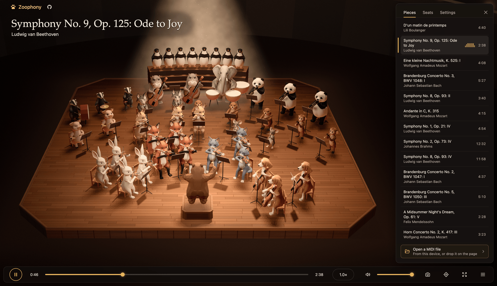

# Zoophony

A WebGL MIDI player featuring low-poly animals playing symphonies.



## Features

- **3D animal orchestra.** Low-poly animals play violin, viola, cello, double bass, woodwinds, brass, and percussion. Poses sync with each note, finger placement, and bow stroke.
- **Custom MIDI playback.** Drop any `.mid` file onto the window, or select from built-in public domain classical pieces.
- **Web Audio SoundFont synth.** A dedicated AudioWorklet synthesizes instruments from SoundFont files with room reverberation.
- **Dynamic camera.** Choose between an automated cinematic camera that follows active sections, and a free orbit camera.
- **Section controls.** Solo or mute any instrument section. The stage spotlight moves to follow solo performers.
- **Lightweight static app.** The application runs entirely in client-side WebGL and Web Audio. The first download stays under 1 MB compressed.

## Getting started

### Prerequisites

- [Node.js](https://nodejs.org/) version 24 or newer
- [pnpm](https://pnpm.io/) package manager

### Run locally

1. Install dependencies:
   ```bash
   pnpm install
   ```

2. Start the local development server:
   ```bash
   pnpm dev
   ```

3. Open `http://localhost:5173` in your browser.

### Build for production

Create a static build in `dist/`:
```bash
pnpm build
```

## Controls

| Key or gesture | Action |
|---|---|
| `Space` | Play or pause |
| `Left` / `Right` | Seek 5 seconds backward or forward |
| `Home` | Return to start |
| `C` | Toggle automatic cinematic camera |
| `M` | Toggle mute |
| `F` | Toggle full screen |
| `Escape` | Close drawer or dialog |
| Drag (> 4 px) | Orbit 3D camera |
| Scroll / Pinch | Zoom in or out |

## Architecture

- `src/score/`: Parses MIDI events into timed notes, sections, and player seat assignments.
- `src/pose/`: Calculates animal poses, bow angles, and finger placements from score time.
- `src/models/`: Builds low-poly animal geometries, rigs, and instrument meshes.
- `src/scene/`: Manages Three.js rendering, lighting, spotlight beams, and camera transitions.
- `src/audio/`: Coordinates the SoundFont synthesizer inside a Web Audio worklet.

## License

- **Code:** the [Apache License 2.0](LICENSE).
- **Animal models:** the files in `assets/models/` and `src/models/studio/` are under
  [CC BY-NC 4.0](https://creativecommons.org/licenses/by-nc/4.0/). You can use, change, and share
  them, but not for commercial purposes.
- **Your output:** you own the videos, images, and audio that you make with Zoophony. You can use
  them for any purpose, including commercial use. This grant covers the animals as they appear in
  your output. It does not cover the model files.
- **Name and logo:** the licenses do not cover the name "Zoophony" or the paw logo. Give a fork a
  different name. It can say that it is "based on Zoophony".
- **Third-party files:** the demo files, the SoundFont, and the hall reverb keep their own
  licenses. The credits dialog of the app and the README file of each folder list them.
