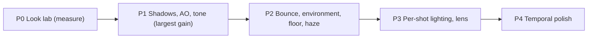

# Cinematic lighting and rendering: audit and plan (2026-10-14)

This report audits the light and the render of the stage (`src/scene/`, the stage material, design
4.1 and 4.5) against the reference images. It gives ranked findings and a plan in phases. Nothing
in it is decided: section 5 lists the conflicts with the design that need a decision of the user.
The measurement script is in [`2026-10-14-cinematic-lighting/`](2026-10-14-cinematic-lighting/).

The frames that the audit compares:

- The current play frame: [`play-1440x900.webp`](../snapshots/2026-10-14-55f27953/play-1440x900.webp)
  of the snapshot `2026-10-14-55f27953`.
- The target: [`orchestra-latest.png`](../reference/orchestra-latest.png) and the close shots of
  [`scene.png`](../reference/scene.png).

## 1. Verdict

The post pipeline is good, and it does not limit the look. It already has a float HDR target with
MSAA, the CoD:AW bloom, a thin-lens depth of field with bokeh, AgX, a grade, grain at 24 Hz, and a
depth-aware volumetric beam. **The gap is in the light model.** The references look like
path-traced renders: soft area shadows that get harder at contact, ambient occlusion, warm bounce
light from the lit floor, and air with haze in it. The app has one hard shadow, no occlusion on the
props or the stage, no bounce light, and black air. Several brightness hacks also stack up, and
together they make the mid tones look milky.

`tone_measure.py` measured the stage area of both frames (luma of the middle band, 0 to 255):

| | p5 | p25 | p50 | p75 | p95 | Median saturation |
|---|---|---|---|---|---|---|
| Current | 27 | 72 | **128** | 175 | 205 | **0.51** |
| `orchestra-latest.png` | 27 | 60 | **107** | 154 | 211 | **0.60** |

The black point and the white point match. The current mid tones are about 20 levels too bright
and less saturated. So the problem is not "too dark" or "too bright". The problem is the shape of
the light and the shadows.

## 2. Findings, ranked by visual impact

### F1. Shadows are hard, black-edged, and have a uniform penumbra

- The PCF blur is a constant 3 texels on a 2048 map (`TIER_SETTINGS` of
  [`quality.ts`](../../src/scene/quality.ts)), with 12 fixed Vogel samples (`SHADOW_SAMPLES` of
  [`shadow-chunk.ts`](../../src/scene/shadow-chunk.ts)). The penumbra stays a few cm wide at
  every distance from the caster.
- The long shadows of the stands and the chairs fan toward the camera as crisp black shapes, and
  they become the strongest graphic element on the floor. In the reference, the shadows are soft.
  They are sharp only where a leg meets the floor, and they fade with distance.
- This one item does the most to make the frame read as a game engine and not as a film.

### F2. No ambient occlusion on the stage, the props, or between players

- Design 4.5 says: "The props and the stage get no occlusion." Only the parametric bodies have a
  baked vertex AO. The studio bodies keep their own AO.
- Chairs, stand feet, the podium base, and the feet of the players do not touch the floor
  visually. In the reference, each chair leg has a dark contact point, and the players darken the
  floor under them.

### F3. No indirect (bounce) light

- The fill is one global `HemisphereLight` (`#302a26` and `#2c241e`, intensity 5, `FILL` of
  [`lights.ts`](../../src/scene/lights.ts)). It has the same strength in the bright pool and at
  the dark stage edge.
- The bright walnut pool should send warm light up into chins, bellies, the undersides of
  instruments, and the chair seats. In the reference, the shadow sides of the animals are warm and
  lit. In the current frame they are a flat dark gray, and the form reads flat.

### F4. Brightness hacks that cancel each other out

| Hack | Where | Effect |
|---|---|---|
| Exposure 0.8 | `rendererSettings()` of [`renderer.ts`](../../src/scene/renderer.ts) | Darkens everything |
| `highlights: 1.0` lift toward white after AgX | `POST_LOOK` of [`post.ts`](../../src/scene/post.ts), `GRADE_FUNCTION` of [`post-shaders.ts`](../../src/scene/post-shaders.ts) | Brightens the mid and high tones again. This causes the milky mids |
| Stage direct specular ×2.0 | `STAGE_FINISH.specular` of [`stage.ts`](../../src/scene/stage.ts) | Breaks energy conservation and makes a broad washed-out sheen |
| `shadowSaturation: 0.45` | `POST_LOOK` of [`post.ts`](../../src/scene/post.ts) | Makes the shadows gray. Film shadows keep their color |
| The pool factor multiplies each spotlight | [`light-pool.ts`](../../src/scene/light-pool.ts) | Not physical, but useful. Keep it |

AgX (default look) compresses and desaturates on purpose. The grade then pushes the image back
toward the mockup. A tone mapper that keeps the base colors removes the need for most of these
hacks.

### F5. The floor shader aliases

- The wood grain is a `fract(sin())` value noise that is stretched along x, with no band limit
  (`GRAIN_GLSL` of [`stage.ts`](../../src/scene/stage.ts)). In the snapshot, it shows as streaks
  and moiré in the far half of the stage, and it will shimmer when the camera moves.
- The floor has no specular anti-aliasing, so the gloss sparkles on the plank seams.
- The floor shows no reflections of the players. In the reference, the walnut is lacquered: a
  sharp clearcoat highlight sits on top of a broad sheen.

### F6. The environment map is synthetic

- The environment is a dark sphere, 10 boxes, and a ceiling box (`ENVIRONMENT` and
  `buildEnvironmentScene()` of [`environment.ts`](../../src/scene/environment.ts)). The piano
  lacquer, the brass, and the copper timpani reflect a pattern that matches nothing in the frame.
  In `scene.png` (07, 08), the brass and the piano lid reflect the lit stage and the lamps of the
  hall.

### F7. No atmosphere outside the beam cone

- The haze exists only in the narrow cone (`BEAM_LOOK` of [`beam.ts`](../../src/scene/beam.ts)).
  The air of the hall is black, so the room reads as a void, and the back rows have no aerial
  depth. In the references, a warm haze glow fills the room. The beam sits inside air, and the
  back row is a little lifted and softened.

### F8. One lighting rig serves every shot

- The automatic camera cuts between wide, conductor, section, and solo shots (design 5.6), but the
  light stays the same, apart from the face light of the conductor (`CONDUCTOR_LIGHT`). On a film
  set, each setup is relit. A close shot gets its own soft key at 30° to 45° off the camera axis,
  a kicker, and its own exposure.

### F9. The lens and film effects are minimal

- The bloom only catches pixels above 1.8 (`bloomThreshold`), so it acts on the lamps and nothing
  else. The diffusion of the reference (the "Pro-Mist" softness on all highlights) is missing.
  There is no halation, the vignette is fixed for every shot, and there is no exposure change
  between shots.

### F10. Temporal stability

- There is no TAA. The thin bows, the strings, the baton, and the stand legs shimmer under MSAA
  alone.
- A smaller finding: the post pipeline renders its own half-size depth pass for the depth of field
  (`#renderDepth()` of [`post.ts`](../../src/scene/post.ts)), and `BeamDepth` already renders a
  full-size depth. That is one more geometry pass in each close shot, and the budget could go to
  AO. The catch: `BeamDepth` hides the hall, and the depth of field needs it.

## 3. Plan

### P0. Look lab (half a day). Do this before any tuning

- Extend `pnpm snapshot` to a fixed set of shots: default, conductor close, section close, side,
  and high. For each shot, write the luma percentiles, the median saturation, the shadow-to-lit
  ratio on the floor, and the GPU time of each pass and each tier.
- Store the crops of the reference with the same metrics, so that each step below gets a number
  and not only an opinion. The repo already uses this method for the models (`sheet-check`).

### P1. Largest gain for the cost

**1a. PCSS soft shadows that get harder at contact** (high tier; medium keeps PCF)

- Patch `shadowmap_pars_fragment`, as `shadow-chunk.ts` already does. Do a blocker search (about
  12 taps), estimate the penumbra from the light size and the receiver-to-blocker distance, then
  filter (about 16 Vogel taps).
- Turn the taps for each pixel with interleaved gradient noise, and reseed it at the grain rate of
  24 Hz. The film grain hides the noise. This answers the old dither problem (SC5) without fixed
  taps.
- Start with a light size of about 0.6 m, which is a real 2 kW Fresnel with its barn doors.
- Cost: about 0.5 to 1 ms at 1440p on M-series GPUs, because only the key light casts shadows.

**1b. Screen-space ambient occlusion (GTAO)**

- Render GTAO at half size from a depth texture, reconstruct the normals from the depth, then do a
  bilateral upsample.
- Apply it only to indirect light. Inject the AO texture into `aomap_fragment` through
  screen-space UVs, so that it multiplies only the hemisphere and the environment terms. Do not
  multiply it into the final color, because that makes dirty halos in the direct light.
- Low tier: add soft blob decals under the chair legs, the stand feet, and the feet of the
  players. One instanced draw costs almost nothing.
- Cost: about 1 to 1.5 ms on the high tier.

**1c. Tone and grade rework**

- Try `NeutralToneMapping` (Khronos PBR Neutral, in three.js r186). It keeps the base colors of
  the toys. Also try AgX with the Punchy look. Then remove `highlights`, set the exposure back
  toward 1.0, and remove the ×2 stage specular. Retune against the P0 numbers.
- Replace the parametric grade with a 33³ 3D LUT in the final pass (one more texture fetch).
  Author the LUT once, in Resolve or Photoshop, from a neutral frame against
  `orchestra-latest.png`. This is the standard method in film work, and an artist can change it
  without code.
- Keep color in the shadows (saturation about 0.8 to 0.9), and use a slight split tone: warm amber
  highlights and neutral to slightly cool shadows. This is different from the rejected warm fill,
  which made the shadows red.

### P2. Physically motivated detail

**2a. Floor bounce light.** In the existing `addLightPool()` chunk, add an analytic term:
`floorAlbedo × poolIrradiance(xz) × (0.5 − 0.5·n.y) × heightFalloff`. A few ALU operations give
the warm undersides that the references have. An alternative that follows the real scene: when a
layout builds, bake a 3 × 3 grid of SH light probes with a `CubeCamera` and `LightProbeGenerator`.

**2b. Captured environment.** When a layout builds, and again after a context restore, render the
hall and the lit stage, with no players, from above the podium into a `CubeCamera`, then make a
PMREM from it. The brass, the lacquer, and the timpani then reflect the real lamps and the real
pool. This costs one render for each layout, and nothing in each frame.

**2c. Floor material**

- Band-limit the grain: fade the octaves out by `fwidth()`, or bake the grain into a mipmapped 1K
  texture.
- Add specular AA: widen the roughness by the screen-space variance of the normal
  (Kaplanyan and Tokuyoshi).
- Change the walnut to a `MeshPhysicalMaterial` look: a broad base roughness of about 0.6 and a
  clearcoat with a roughness of about 0.15. This gives the reference look of a broad sheen with a
  crisp lacquer highlight, and it replaces the ×2 hack. The clearcoat lobe is the extra cost, and
  the stage is a single mesh.
- Optional on the high tier: screen-space reflections on the stage top only, faded by distance
  (soft reflections of the players in the lacquer).

**2d. Room haze.** Add exponential height fog in the final pass from the full-size depth. Give it
a warm in-scatter that grows when the view ray points toward the key light (Henyey-Greenstein
phase, g ≈ 0.6). The beam then sits inside air, the back rows get aerial depth, and the hall stops
reading as a void. Keep the rule of the beam that no player gets veiled: give the fog a low
density, and let it grow with distance more than with height.

### P3. Cinematography

**3a. Per-shot lighting cues.** Each shot type of the planner (5.6) gets a small light preset, and
the cut eases or switches the light with the camera:

- Close shot: a soft key 35° off the camera axis, a kicker or rim from the side of the key light,
  +0.3 EV, and a wider vignette.
- Wide shot: today's rig.
- Solo: a second narrow follow-spot on the soloist, with the existing `soloAim()`.

The present `CONDUCTOR_LIGHT` is the first case of this pattern. Make it the general rule.

**3b. Lens and film**

- Diffusion: add a second bloom tap with no threshold at about 3% strength from mips 2 to 4. This
  gives the soft glow of the highlights in the reference.
- Halation: a red-orange tint of the bloom of the bright edges.
- Chromatic aberration at the edges below 0.5 px.
- A vignette for each shot.
- All of these go in the existing final pass, so they cost about 0.1 ms.

**3c. Music-reactive light** (a product question). Ease the intensity of the key light by ±5%
with the loudness envelope, and let the brass gleam on accents. This is subtle, and it is common in
concert films.

### P4. Temporal polish

- TAA needs motion vectors for the skinned meshes, and three.js does not supply them. That costs a
  lot. A cheaper choice is to widen the roughness of the thin glossy parts (the bows and the
  strings) and to add a small mesh line width with alpha-to-coverage on the strings.
- Let the depth of field reuse a downsample of `BeamDepth` where the shot does not show the hall,
  or add the hall to `BeamDepth` with a mask bit. This removes one geometry pass in each close
  shot.

## 4. Budget by tier

These are estimates for 1440 × 900 at a pixel ratio of 2 on an M-series GPU, not measures. P0
measures them.

| Item | High | Medium | Low |
|---|---|---|---|
| PCSS | Yes (about 0.8 ms) | PCF (today) | PCF 512 (today) |
| GTAO at half size | Yes (about 1.2 ms) | Quarter size | Blob decals |
| Bounce term or SH probes | Yes | Yes | Yes (ALU only) |
| Captured environment | Yes | Yes | Yes (once for each layout) |
| LUT grade, diffusion, halation | Yes | Yes | LUT only |
| Height fog | Yes | Yes | Yes (ALU only, needs depth) |
| Floor SSR | Optional | No | No |

The freed depth pass of the depth of field (P4) and the removed grade math pay back part of the
cost.

## 5. Design conflicts that need a decision of the user

AGENTS.md requires a decision of the user for each change that conflicts with the design. The
design file and a decision row change in the same commit.

| # | Design today | Proposal |
|---|---|---|
| D1 | 4.5: "The props and the stage get no occlusion." | Screen-space AO on everything, applied to indirect light only |
| D2 | 4.5: AgX plus a highlight lift in the grade | Neutral or AgX Punchy plus a 3D LUT, with no lift and no ×2 stage specular |
| D3 | 4.5: "A low, nearly neutral `HemisphereLight` is the fill" | Keep the neutral fill, and add a bounce term that follows the pool |
| D4 | 4.1 and 4.5: one light rig for all shots | Light presets for each shot type (P3a) |
| D5 | 4.5: the haze only in the beam cone, so that no player is veiled | Add a thin room haze that grows with distance |
| D6 | 4.5: shadow sampling with no noise (SC5) | PCSS with noise turned at 24 Hz and hidden by the grain, checked against SC5 in close shots |

## 6. Recommended first three steps

1. P0, the look lab. All later tuning needs it.
2. 1a (PCSS) and 1c (tone and LUT). This is the largest visual change for the cost, and it touches
   only `shadow-chunk.ts`, `renderer.ts`, `post.ts`, and `post-shaders.ts`.
3. 1b (GTAO) and 2a (bounce light). These ground the players and give them form.
