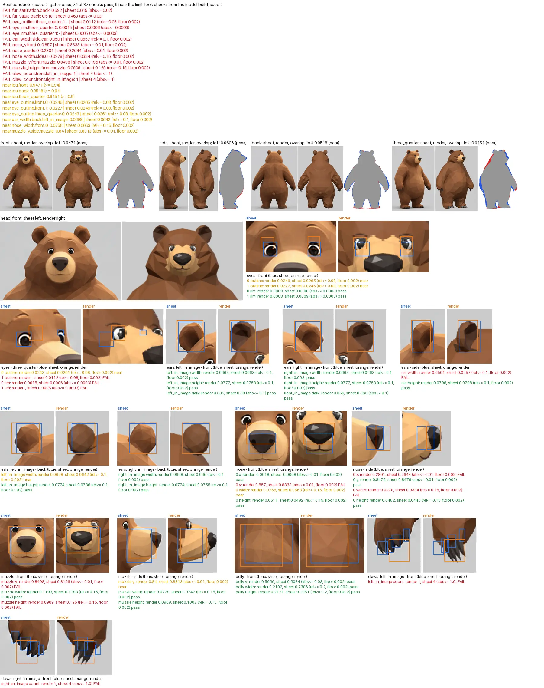

# Low-poly studio

The studio makes a rigged, animated, low-poly animal (one GLB file) from one reference sheet.
Each animal is a folder with a config file. A role pack says what the animal does: conduct, play
the piano, or play the violin. The code is generic: a new animal is a new config, and a new role
is a new folder.

The studio is a separate project inside the repository. The app (`src/`) imports no studio code
and uses no GLB file of the studio. The bodies of the app are rigged meshes in the GLB format of
the studio: `pnpm rig-mesh` writes this format, and `pnpm studio-body` reads it
(`docs/agents/rigging.md` of the repository). Thus a change of the GLB format of the studio (the
bone names, the shape keys, the clip `reference`) needs a change of these tools. The lint of the
repository skips the studio.

The studio has three animals. Each one is a regression animal (see "Regression"):

| Animal | Role | Folder |
|---|---|---|
| bear | conductor (standing, a baton) | `animals/bear/` (its README gives the method and the numbers) |
| polar bear | pianist (seated at a grand piano) | `animals/polar-bear/` |
| rabbit | violinist (seated, a violin and a bow) | `animals/rabbit/` |



The image is the review image of the bear. Git keeps only this render of each animal.
`python3 studio build bear` makes the compare image (`out/compare/compare.png`) and the other
renders again (see "The outputs that git keeps").

## Quick start

Run the commands in this folder (`lowpoly-studio/`). The studio needs python3 3.11 or later with
Pillow, Blender 5.2 or later (`blender` on the path, or the variable `BLENDER`), Node 24, and the
packages of the repository (`pnpm install --offline` in the repository root).

```bash
python3 studio build bear            # build, model build, shots, measures, checks, look report
                                     # (about 70 s cold, about 17 s from the stage cache)
python3 studio build bear --all-seeds --no-shots   # the full seed check (76 s cold, 9 s cached)
python3 studio report bear           # the look report of the last build on a free port
python3 studio view bear             # the viewer on a free port; Ctrl-C stops it
python3 studio view bear --stop      # stop a viewer that runs in the background
python3 studio log bear              # the timeline of the builds: real times, seeds, cache hits
python3 studio regress bear          # build again and compare with the golden stats
python3 studio new fox --sheet fox-views.png --like bear   # start a new animal (compact
                                     # config from the bear, sheet check)
python3 studio calibrate fox --from bear   # light, palette, dark classes from the sheet (5 s)
python3 studio calibrate fox --quads --no-look   # the QuadriFlow target (about 60 s)
python3 -m unittest tests.test_intake   # the tests of the foreground rules (about 13 s)
python3 -m unittest tests.test_cache    # the cache keys hold no worktree folder (about 8 s)
python3 -m unittest tests.test_consistency   # the sheet check reads no config class (about 2 s)
```

All worktrees of the repository share the stage cache and the run files in
`<git common dir>/lowpoly-studio/` (`cache/`, `runs/`). Thus the first build in a new worktree
takes its stages from the builds of the other worktrees (about 4 s for one bear seed).

## Layout

```text
lowpoly-studio/
├── studio/              generic code and the CLI (python3 studio ...)
│   ├── __main__.py      the entry point (cli.py has the commands)
│   ├── config.py        loads animal.toml and role.toml, checks them against schema.py
│   ├── schema.py        every config field: kind, default, meaning
│   ├── build.py         the Blender build: the list of stages (stages.py runs them)
│   ├── stages.py        the stage runner: stage folders, times, and the cache of each stage
│   ├── cache.py         the stage cache: the keys (inputs, config reads, code), the store
│   │                    that all worktrees share
│   ├── outputs.py       build.json, look.json, the old outputs, the stale look checks
│   ├── runlog.py        the run files and the timeline of `studio log`
│   ├── intake.py        sheet -> masks and row profiles (Pillow): the colored rule or the
│   │                    difference rule (intake.foreground)
│   ├── consistency.py   the sheet check of the intake: where the views disagree
│   ├── like.py          the compact config of `new --like` (edits of the like config text)
│   ├── calibrate.py     `calibrate`: the light, the palette, and the dark classes (Pillow)
│   ├── quads.py         `calibrate --quads`: the QuadriFlow target (Blender)
│   ├── sdf.py field.py  distance primitives, lofts from the masks, the field grid
│   ├── remesh.py        warps, QuadriFlow with mirror, organic pass, cleanup, body object,
│   │                    the remesh gate
│   ├── organic.py       mirrored edge collapses and flips, relax, sliver cleanup
│   ├── paint.py         face colors and baked occlusion
│   ├── details.py       eyes, brows, nose, mouth, ears, tail, claws
│   ├── props.py         the props of a role: sized from the body, built by props/; scene
│   │                    props as nodes, the moving keys (ScenePose)
│   ├── gallery.py       the props gallery of an animal (studio props)
│   ├── weights.py       armature, bone heat, weight arrays, fold repair
│   ├── skinning.py      linear blend skinning, face normals, fold measures
│   ├── contacts.py      the contact and fold check of each clip, the frame cache of the
│   │                    check, and the places of each contact and fold (the stage
│   │                    "diagnostics")
│   ├── scene_check.py   the scene check of each clip: the body in a prop, on the seat, and
│   │                    the claw tips on the key targets
│   ├── ik.py bake.py    rotation math, two-bone IK; clip baking into actions
│   ├── reach.py         the IK reach of the clips and the arm of a held instrument (pure
│   │                    Python)
│   ├── roles.py         the interface to the role packs
│   ├── export.py        materials, join, shape keys, glTF export
│   ├── checks.py        the structured check report (checks.json) with the place of each failure
│   ├── locate.py        the fold debug list and the crops of the located failures (diag/)
│   ├── report.py        the look report page and the review image (report/)
│   ├── drawing.py       Pillow helpers of the crops: fonts, labels, side by side crops
│   ├── regress.py       golden stats and their compare
│   ├── views.py fit.py  sheet cameras, IoU of the field with no mesh
│   ├── measure_features.py  the features of measure.features (eyes, ears, nose, ...), Pillow
│   ├── measure_shading.py   the facet shading of the front view (Pillow)
│   ├── measure_mesh.py      the GLB facets (Blender)
│   ├── viewer_config.py writes out/viewer.json for the pages
│   └── shoot.mjs        headless renders: compare, frames, viewer shot (stops at the first
│                        page failure)
├── templates/biped/     the body plan, the 31-bone rig, the solver, the weight rules,
│                        the correctives, the contact groups, the digits ([rig] fingers),
│                        the seat of a seated pose
├── props/               the prop library: shapes.py (the parts), piano.py, bench.py,
│                        chair.py, stand.py, strings.py (violin, cello, bow), gallery.toml
├── roles/conductor/     role.toml, the clips (__init__.py, clips.py), shots.json,
│                        pattern.py (the 4/4 plot)
├── roles/pianist/       role.toml (bench, piano, seated bind pose), clips.py, shots.json
├── roles/violinist/     role.toml (chair, violin in the left paw, bow), clips.py, shots.json
├── roles/model/         the role of the model build: a fixed standing bind pose, one clip
├── viewer/              viewer, compare page, frames page, props gallery page (three.js),
│                        read viewer.json
├── animals/<id>/        animal.toml, golden.json, README.md (bear, rabbit), reference/, out/
│                        (git keeps only the files of "The outputs that git keeps")
├── tests/               python3 -m unittest: test_intake.py (the foreground rules),
│                        test_cache.py and setup_keys.py (the cache keys),
│                        test_consistency.py (the sheet check), test_role_props.py (the
│                        attachments of the props), test_ear_checks.py (the ear measures),
│                        test_reach.py (the reach checks of a held instrument),
│                        test_ear_box.py (the ear box), test_like_scale.py (the scale of
│                        new --like)
├── docs/                handoff.md (the state, the rules, and the open problems),
│                        sheet-spec.md (the rules of a reference sheet), brief-template.md
│                        (the brief of a round), retro/scripts/ (the scripts that measure the
│                        transcript of an agent round)
└── vite.config.js       the root of the pages is this folder
```

No module of `studio/` names an animal. The numbers of the bear are in
`animals/bear/animal.toml`, and the numbers of the conductor are in `roles/conductor/`.

## How a build runs

`python3 studio build <animal>` runs these stages. The Blender stages run in one Blender process
for each seed, and the seed pool runs 4 seeds at a time. With shots, the model build (see "The
model build") runs the same stages with the role `model` in one more Blender process beside the
pool. Each Blender stage is a function with named inputs and named outputs (`studio/build.py`).
`studio/stages.py` writes its outputs, its time, and its source (a run, or the stage cache) into
`out/stages/<nn>-<stage>/`. The remesh gate runs after "remesh" and after "organic" (see "The
remesh gate").

```text
 sheet.png ──> intake ──> masks, measure.json
                                │
 animal.toml ─┐                 v
 role.toml ───┴─(bind pose)─> field ──> remesh ──> organic ──> paint ──> details
                                                                           │
               role.toml (props, correctives, clips) ──> rig ──> correctives ──> assemble
                                                                           │
                              clips ──> contacts (+ fold repair) ──> export: GLB, stats
                                │                                          │
                                │                diagnostics: the places ──┤
                                │                of the contacts and folds │
        seed pool, 4 at a time: the first seed of facets.seeds that passes ┘
                                                                           │
   model build: the same stages with roles/model/ (a standing bind pose),  │
   beside the seed pool ──> out/model/<id>.glb                             │
                                    │                                      v
               compare with the sheet <──┘          frames, viewer, role plots (shots)
                     │                                                     │
                     v                                                     v
                     measures (features, shading, mesh) ──> checks (+ diag/) ──> look report
```

| Stage | Where | Inputs | Outputs | Time (bear, cold) |
|---|---|---|---|---|
| intake | CLI, Pillow | sheet, `sheet.*`, `intake.*` | masks, `measure.json`, `sheet-check.json` | 2.9 s |
| field | Blender | body parts of the template | dense mesh (surface nets) | 1.5 s |
| remesh | Blender | dense mesh, `facets.*`, seed | mirrored triangles | 2.0 s |
| organic | Blender | triangles, `facets.*`, seed | body mesh and object | 15.4 s |
| paint | Blender | body mesh, `paint.*`, `look.materials` | face colors, occlusion, body stats | 0.4 s |
| details | Blender | body mesh, `details.*` | detail meshes | 0.0 s |
| rig | Blender | body object, `rig.*`, role props | armature, weights | 0.1 s |
| correctives | Blender | weights, role `bind.correctives` | shape keys and their drivers | 0.1 s |
| assemble | Blender | details, role props | joined mesh, shape keys, tip markers | 0.0 s |
| clips | Blender | the role pack | actions, sampled poses | 3.9 s |
| contacts | Blender | clips, weights, role checks | contact and fold report, repaired weights | 20.6 s (about 1.3 s after a change of one clip, from the frame cache) |
| export | Blender | all | `out/<id>.glb`, `out/<id>.stats.json` | 1.9 s |
| diagnostics | Blender | the contact checks (`contacts.JOURNAL`), the mesh | the places of the contacts and folds, the fold debug list | 0.05 s |
| model build | Blender | the stages field to diagnostics with the role `model` | `out/model/<id>.glb` | 2.5 s from the cache |
| shots | CLI, node | the model GLB (compare), the role GLB (frames, viewer), `viewer.json` | `out/compare/`, `out/frames/` | 9.9 s |
| measures | CLI | renders, sheet, the model GLB | `features.json`, `topology.json`, `mesh.json` | 2.1 s |
| checks | CLI | all outputs, limits | `out/checks.json`, `out/diag/`, `out/report/` | 1.8 s |

A cold build of the bear takes about 66 s (Blender about 50 s with its start). With the stage
cache, the GLB of a change of an eye radius or a paint color takes about 5 s (see "Speed"). Each
build prints a table of the time and the source of each step and stage. It writes the table to
`out/stages/pipeline.json`, `out/stages/run.json`, and its run file (see "Run files and the
timeline").

The model stages (field to details) take one input from the role: the bind pose. Two roles with
the same bind pose give the same mesh. `roles/model/` has the bind pose of the conductor, so a
conductor build and its model build share the model stages in the cache.

## The CLI

| Command | What it does |
|---|---|
| `python3 studio build <animal>` | Runs the intake and the role build: the seed pool builds the seeds of `facets.seeds`, 4 at a time, each in `out/seeds/<n>/`, and the first seed in the config order that passes the remesh gate and the clip gates comes into `out/`. With shots, the model build runs beside it (`out/model/`). Then the shots, the measures, and the checks run. After a change of the role pack, the template, or `--clips`, the pool runs every seed (a role check) and writes `out/seed-report.json` (see "The seed rule"). Exits 1 when no seed passes, a gate fails, or the seed rule (`seeds.require`) fails. |
| `--seed N` | One seed only, built in `out/`. The model build keeps its own seed. |
| `--all-seeds` | The full seed check: build every seed, write `out/seeds/summary.json` and `out/seed-report.json`, and keep the first seed that passes. Exits 1 when the seed rule fails. |
| `--jobs N` | Blender processes of the seed pool at the same time (default 4). The model build runs beside them. |
| `--no-cache` | No stage cache reads or writes (a cold build). |
| `--no-gate` | Report the remesh gate, but build on when it fails (to look at a seed that fails it). |
| `--no-shots` | Stop after the GLB and the checks of the stats (no model build, no renders, no measures). The look checks of the earlier renders are marked stale (see "Old and stale outputs"). |
| `--out DIR` | Another output folder (default `animals/<id>/out`). Keep it under `lowpoly-studio/` when you want shots: the page server serves only this folder. |
| `--until STAGE` | Stop the Blender build after this stage (no GLB), for example `--until organic` to look at the mesh stages. |
| `--clips a,b` | Bake only these clips. |
| `python3 studio compare <animal>` | Renders the GLB of the model build beside the sheet, and the frames and the viewer shot of the role GLB, then the measures and the checks. No new role build. When `out/model/` does not hold the model GLB of the build in `out/`, it builds the model first (from the stage cache). |
| `python3 studio view <animal> [--port N] [--stop]` | Writes `out/viewer.json`, starts Vite on a free port (never 5173 or 5190), writes the pid file `out/view-server.json` (the pids, the port, the URLs), and prints the URLs of the viewer and the compare page. Ctrl-C, SIGTERM, or `view <animal> --stop` stops the server and Vite, also when it runs as a background job (the shell then ignores Ctrl-C). A second `view` prints the URL of the running server. |
| `python3 studio log [<animal>] [--all] [--last N] [--short] [--json]` | Prints the timeline of the runs of `build`, `regress`, and `compare` from their run files: the start, the wall time, the command, the seed and the model seed, the cache hits, the result, the time and the source of each step and Blender stage, and the seeds of the pool. `--all` shows the runs of all worktrees. Report these times, and do not guess them. |
| `python3 studio new <animal> --sheet <png> [--like A] [--role R] [--full] [--foreground F]` | Makes `animals/<animal>/` (the id: lower case letters, digits, hyphens, and underscores) with the sheet in `reference/` and an `animal.toml`, runs the intake with its sheet check, and prints the intake checklist. It finds the background, the four view columns, and the rows of the compare tiles (`compare.rows`) by the intake rule `--foreground` (default `difference`). With `--like A`, the config is the compact config of A: the config file of A with its comments, the measured fields of the new sheet (marked "measured by studio new"), and the methods of a new animal (`intake.foreground = "difference"`, `checks.feature_pixels = 1.0`, and `compare.head_turn` of the 3/4 view: the turn that the sheet check measures, plus or minus 6 degrees). `fit`, `calibrate`, and a first build run at once. `--full` (or no `--like`) writes the scaffold of every field with "TODO" fields. `--role` defaults to the role of A. |
| `python3 studio calibrate <animal> [--from A] [--quads] [--no-look] [--contrast X] [--dry-run]` | Fits the look to the sheet (see "Calibrate"): the hemisphere and the key light, the palette, and the dark color classes, with renders of the GLB of the animal (of its model build when it exists, or of A, for a new animal with no GLB). It warns when a color class that decides a feature takes fur pixels. `--quads` also measures the QuadriFlow count on the field and sets `facets.quadriflow_target`. Writes the values into `animal.toml` with a comment, and `out/calibrate/look.json` and `quads.json`. `--dry-run` writes nothing into the config. |
| `python3 studio fit <animal> [--rows] [--azimuths a,b,c] [--pose bind]` | Scores the field against the masks with no mesh (about 2 s: Blender start, field, four views). `--rows` prints the edges of each row. `--azimuths` tries these azimuths of the 3/4 view and keeps the best. `--pose bind` scores the field of the bind pose. |
| `python3 studio report <animal>` | Writes the checks, the located failures (`out/diag/`), and the look report (`out/report/index.html`, `review.png`) of the last build, then serves `out/` on a free port (never 5173 or 5190) until Ctrl-C. `--measure` measures the features and the shading of the existing renders again first (a feature box change takes about 3 s). `--no-serve` only writes the files. `--out DIR` reads another output folder. |
| `python3 studio regress <animal>` | Builds with the golden seed into `out/regress/` (with the model build) and compares with `golden.json`. `--no-cache` makes the build cold. `--no-build` compares the last regression build. `--write --from DIR --note TEXT` writes a new `golden.json` from a build. |
| `python3 studio props <animal> [--role R] [--no-shots]` | Builds the props gallery (see "The prop library"): one prop of each kind of `props/gallery.toml`, sized from the body of the animal in a seated bind pose (the role of the animal when it sits, else `pianist`), into `out/props/gallery.glb` and `gallery.json`, and renders `out/props/props.png`. The page `viewer/props.html` shows the props one at a time. About 8 s. |
| `python3 studio cache info\|clean [<animal>]` | Prints the size of the shared stage cache by step and by animal, or deletes the entries of one animal (or the whole cache). |
| `python3 studio schema [--role] [--readme]` | Prints the config reference (or the role reference) as Markdown. `--readme` writes both into this README. |

Debug prints: `STUDIO_DEBUG=1` makes the build print each face that points into the body, each
face that the fold repair smooths, and each face that stays folded, with its place and weights.
Each build also writes the same facts into `out/diag/folds.json`, with no flag.

When no seed passes the gates, the outputs of the last seed that ran come into `out/`. The build
writes `checks.json`, `out/diag/`, and the look report of that seed, then stops with exit 1.

The Blender log of each seed is `out/stages/blender-seed<N>.log` (in the seed pool:
`out/seeds/<n>/stages/blender-seed<N>.log`, in the model build:
`out/model/stages/blender-seed<N>.log`).

## Add a new animal

These steps make a new animal from a sheet. The agent skill `lowpoly-animal-studio` gives the
same loop with its traps. Take each time from `python3 studio log <id>`.

```text
 sheet + intake --> new --like (5 s) --> calibrate --from (5 s), --quads (60 s) --> fit (2 s)
                                                                                     |
     +-------------------------------------------------------------------------------+
     v
 build: seed pool (role build) + model build (look checks) --> report (review.png)
     ^                                                            |
     +---- fix one gap, `build --seed <kept>`, calibrate again <--+
                          | the look is right on the model build
                          v
 seed report (out/seed-report.json) --> golden.json in its own commit --> role
```

1. Get a sheet that follows `docs/sheet-spec.md`: four views of one pose (front, side facing
   right, back, 3/4 front-right) on one plain background, one ground line, the arms a little
   away from the body, at least 500 px of figure height. The spec has a prompt for an image
   generator.
2. Settle the style before the first build, each claim with a crop of the sheet: the facet
   size, the light and the contrast, the palette, the eyes, the head, the snout, the ears,
   symmetry, "no folds at any seed", and the bind pose of the role. A manager writes the brief of
   each round from `docs/brief-template.md`.
3. Start the animal: `python3 studio new <id> --sheet <png> --like bear` (about 5 s, `--role R`
   names another role). It writes the compact config of the like animal, makes the masks, and
   runs the sheet check. The fields of the new sheet are marked "measured by studio new", and
   `compare.head_turn` of the 3/4 view comes from the sheet check. Read the sheet check
   (`out/sheet-check.json`): each warning names the build checks that the sheet can fail. Settle
   each fault of the sheet before the work starts.

   The compact config drops `field.ears.box_pad` of the like animal, so the box of the ears
   follows the ear radii: the largest radius plus the blend plus 0.01 (`ear_box_pad()` of
   `studio/config.py`). A box from an animal with short ears can cut long ears: the field grid
   loses its top rows, and `fit` scales the body to the lower top. A config that gives `box_pad`
   keeps it.

   When the body of the new sheet has another height than the body of the like animal, `new`
   scales the values in animal heights that come from the like animal by the body height ratio
   (`scale_like()` of `studio/cli.py`, `SCALED` of `studio/like.py`). The body height is the
   crown: the top of the head at the axis of the front view, between the ears. The intake of the
   like animal runs into a temporary folder for its crown. A ratio within 0.03 of 1 keeps the
   values. Each scaled line gets the comment "scaled by studio new", and `new` prints the list.

   | Scaled (only the lengths: factors, flags, and names stay) | Not scaled, and why |
   |---|---|
   | `facets.offset` (the skin offset), `facets.squeeze`, `facets.warps` (center, radius), `facets.protect` | `field.*`: `fit` measures the field on the sheet |
   | `rig.spine`, `rig.tail_bone`, `rig.fingers_length` | `details.*`: `fit` and the look checks measure the eyes, the nose, the ears, and the claws |
   | `rig.weights`, `rig.weights.trunk` (`x_scale` and `muzzle_scale` stay) | `rig.ear_bone`: it is in the frame and the size of the ear |
   | `measure.mesh_belly`, `measure.shading` (`jump` stays) | `rig.clavicle`: a rule of the arm motion of the role |
   | `measure.features.<name>.regions` | the regions of a feature of the method `bump` (the ears): the top of the silhouette stays at 1 |
   | `compare.facet_crops` | `paint`, `look`, `checks`, `seeds`, `measure.classes`: no lengths |

   The skin offset (`facets.offset`) follows the thickness of the limbs more than the height of
   the body. Check it in the first build.
4. Calibrate: `python3 studio calibrate <id> --from bear` (about 5 s) sets the light, the
   palette, and the dark classes from the sheet with renders of the bear GLB. Read its warnings:
   a color class that takes fur pixels, a color that clips, a paint contrast that the light
   cannot reach. `python3 studio calibrate <id> --quads --no-look` (about 60 s) measures the
   QuadriFlow count on the role field and the model field and sets
   `facets.quadriflow_target`. The sheet check reads no config class, so calibrate does not
   move it.
5. Measure and fit: replace the values of the like animal with measures of the sheet, in
   animal heights. Run `python3 studio fit <id> --rows` (about 2 s, no mesh) after each set of
   changes. Tune the head first (cheek, dome top, snout cone, chin), then the ears and the arm
   x, then the 3/4 azimuth (`python3 studio fit <id> --azimuths 38,40,42,44,46`).
6. Build: `python3 studio build <id>`. The seed pool keeps the first seed of `facets.seeds` that
   passes every gate (the role build, in `out/`). The model build runs beside it with
   `roles/model/` (a fixed standing bind pose, no props, its own seed) into `out/model/`, and
   the look checks read its GLB. The first pool build of a role runs every seed (a role check)
   and writes `out/seed-report.json`. Each gate failure prints its place: fix the field at that
   place before you change a limit. After the first build, run `python3 studio calibrate <id>`
   again: it renders the model GLB of the animal itself.
7. Read the report: `out/report/review.png` first (the numbers and the key crops in one image),
   then each failing gate and look check in `out/report/index.html` or `out/checks.json`. A
   check marked `stale` reads old renders (`python3 studio compare <id>` renders again). A
   check marked `sheet` can come from a fault of the sheet.
8. Fix one gap at a time: edit the config, and build the kept seed again
   (`python3 studio build <id> --seed <kept>`). From the cache, the GLB of a paint, light, or
   detail change takes about 5 s (`--no-shots`). Set the light before the palette. Change
   numbers in the config, never in the code. To tune a feature box, run
   `python3 studio report <id> --measure` (about 3 s).
9. Read the seed report before you call the model or a clip done: `out/seed-report.json`, or
   `python3 studio build <id> --all-seeds --no-shots`. With `seeds.require = "kept"` (the
   default), only the kept seed must pass, so the exit code says nothing about the other seeds.
   Read them, and list each failed seed with its place. `seeds.require = "all"` makes each seed
   that passes the remesh gate pass every clip (see "The seed rule").
10. Keep the result: `python3 studio regress <id> --write --from animals/<id>/out --note
    "<what and why>"`, and commit `golden.json` in a commit of its own with the reason. Commit
    the config, the sheet, `out/`, and the README of the animal after each part. Stage each
    path by its name.
11. Give it a role: set `[animal] role` and build again, or write a new role pack (see "Role
    packs"). The look checks stay on the model build.

## Role packs

A role pack says what the animal does. It is one folder under `roles/`:

| File | Content |
|---|---|
| `role.toml` | The data: the stance, the bind pose and its correctives, the props with their attachment, the clip notes, the body of the IK targets, the role checks, the review outputs. `studio/config.py` checks it against the `ROLE` schema. |
| `__init__.py` | `make(ctx)` returns the pack object: `fps`, `clips`, `performance`, `blend`, and optionally `hand_targets`. |
| more | The clip code, the review shots (`shots.json`), review scripts (`pattern.py`). |

The studio calls nothing else of a pack. Thus a new role is a new folder and no change of the
studio code. A new prop kind or a new corrective kind is a change of the studio or of the
template. The pack object has this shape:

```typescript
/** The pack object that make(ctx) returns (roles/<name>/__init__.py). */
interface RolePack {
  /** Frames per second of the baked clips (role.toml [clips] fps). */
  fps: number;
  /** The clips in the order of the GLB. The first clip is 'reference', from
   *  ctx.reference_clip(): the pose of the sheet, for the compare and the correctives. */
  clips: Record<string, [(t: number) => PoseSpec, number]>;
  /** Segments [clip, start time in the clip, duration] of a clip "performance", or []. */
  performance: Array<[string, number, number]>;
  /** Blend time at the joins of the performance, in seconds. */
  blend: number;
  /** Optional: the targets of the paws that press a key at time t of a clip, in model space,
   *  or null for a clip with no presses: the knuckle of a paw (one finger bone), or the claw
   *  tip of each pressing digit ([rig] fingers > 1). The scene check measures the posed points
   *  against them (gate hands.<clip>, role.toml [checks] hand_targets). */
  hand_targets?(clip: string, t: number):
    { L?: Vec3 | Record<number, Vec3> | null; R?: Vec3 | Record<number, Vec3> | null } | null;
  /** Optional: the names of the piano keys that the clips press ('E5', 'Cs4'). Each one gets a
   *  node under the piano, and a pose spec turns it with spec.keys = {name: press share 0..1}. */
  pressed_keys?: string[];
}

/** What a pack gets from the studio (studio/roles.py Context). */
interface RoleContext {
  cfg: AnimalConfig;            // cfg.role is the role.toml
  body: TemplateBody;           // arm_pose(pose), leg_pose(pose), parts, reference_spec
  rest_skeleton(): [Skeleton, BoneLayout];   // the solver without Blender
  prop_points(name: string, pose?: string): [Vec3, Vec3];   // grip and tip of a hand prop
  reference_clip(): [(t: number) => PoseSpec, number];
  /** Moves a wrist target from the body of role.toml [targets] onto this body (the shoulder
   *  of the side, scaled by the arm reach). The identity for the body of the targets. */
  place(side: 'L' | 'R', p: Vec3): Vec3;
  unplace(side: 'L' | 'R', p: Vec3): Vec3;
}
```

A pose spec is the input of the template solver (`templates/biped/solver.py`): relative bone
rotations (also of each digit), a hips offset, IK targets of each arm (wrist, elbow pole, hand
direction, palm, twist share), forward kinematics of the arms or the legs, the scale of each prop
(`<prop>_scale`), and planted legs. `keys` ({key name: press share}) turns the key nodes of a
piano (`props.ScenePose`).

### Add a role

1. Copy `roles/conductor/` to `roles/<name>/`.
2. Edit `role.toml`: the stance, the bind pose in the middle of the motion range of the role,
   the props, the clip notes, the checks, and the review outputs.
3. Write the clips in `__init__.py` (and modules beside it): functions of time that return pose
   specs. Make the IK targets on one body, and put that body in `[targets]`.
4. Set `role = "<name>"` in an animal config and build.

### The pianist role (a seated role)

`roles/pianist/` seats the animal on a bench at a grand piano. The polar bear plays it.

The seated pose and the scene come from the body, so another animal gets its own seat, keyboard
height, and key width:

```text
 role.toml [bind], [rig]        props.scene_layout(body)              clips (roles/pianist)
 hip_flex 70, knee_flex 70 ---> drop: lowest point of the     ---->  hips offset (0, -drop, 0),
 hip_abduct 14 (knees apart)    bent soles                           lean 12 deg, sway, nod
 arms 42 deg forward            seat: Body.seat height map           a hand position per paw:
 fingers = 4 (digits)           keys top: elbows - 0.06              digit k over its key
                                key width: claw tip spacing          a note curls one digit:
                                       |                             claw tip onto the key,
                                       v                             key down by the dip
                bench (pad fitted to the body), piano: nodes                  |
                pressed keys: nodes under the piano  <--- spec['keys'] -------+
                                       |                                      v
                     scene check: scene.<clip>, seat.<clip>, hands.<clip> (claw tips)
```

The clips: `reference` (the sheet pose, the props hidden), `ready` (the paws over the first
notes, the digits a little up), `play` (two bars at 120 bpm: the first line of "Ode to Joy" with
single digits of the right paw, two-digit chords of the left paw on beats 1 and 3, a sway, and a
nod, as a loop), `chord` (the paws rise, three digits of each paw strike a big chord, hold, and
lift), `rest` (the paws on the outer tops of the knees), and `performance` (ready, play two times,
chord, rest).

| Part | Where | What it does |
|---|---|---|
| Seated bind pose | `[bind] hip_flex`, `knee_flex`, `hip_abduct` (templates/biped `Body.leg_rotations`) | The mesh is built and bound with the legs bent, so the seated clips stay near the bind pose. `hip_abduct` turns the knees apart: thighs side by side leave a slit between them, which the remesh gate stops. |
| The drop onto the seat | `Body.seated_drop()`, `props.scene_layout()` | The clips offset the hips down by the height of the lowest point of the bent soles, so the feet stand on the floor. |
| The seat | `Body.seat()`, `bench.fit` (props/bench.py) | The seat reaches from behind the rump to the backs of the shins. Its height map is the lowest body point over each spot, up to the plane of the thighs. The pad of the bench takes this form, as a soft pad under a heavy body: it rests at the thighs, and the rump and the hanging belly push it down. Thus the rump and the thighs both rest on it. |
| Digits | `[rig] fingers = 4` (templates/biped, see "The biped template") | Each paw has one digit bone for each claw, from inside the paw to the claw tip. |
| Keys and hand positions | `props.piano_keys()`, `Paw`, `Pianist.place()` | A white key is as wide as the spacing of the claw tips, so in a hand position each digit is over its own key. For the right paw, digit 1 (inner) is on the home key and digit 4 three white keys higher. For the left paw, digit 4 is three white keys lower. A straight digit has its claw tip on the key top, and a digit that does not play is lifted 12 degrees. |
| A note | `Pianist.fingers()`, `envelope()` | The digit curls down until its claw tip is on its key (`Paw.curl_for`, a bisection on the tip height), then pushes the key down by the key dip, and lifts. The press share of each key goes into the pose spec (`spec['keys']`), and the key node of the piano turns with it. |
| Scene props | `[[props]] kind = "piano"` and `"bench"`, `attach.bone = "scene"` (studio/props.py) | Each prop is a mesh node of its own in the GLB with no bone. The keys that the pack presses (`pack.pressed_keys`) are nodes under the piano. The sheet pose hides the props (node scale 0). The props give their test boxes to the scene check. |
| Wrist targets | `Pianist.arms()` | The clips make wrist points in model space, and turn them into wrist targets in the rest frame of the chest of the same pose (the frame of the solver). |
| Role checks | `[checks] scene_depth`, `seat_gap`, `hand_targets` (`studio/scene_check.py`) | Gates of each clip: `scene.<clip>` (the deepest body skin point in a prop box), `seat.<clip>` (the larger gap of the rump skin and of the thigh skin to the top of the pad under them), `hands.<clip>` (the distance of the claw tip of each pressing digit from its target). |
| Correctives | `[bind] correctives = ["arm_down", "legs_straight"]` | `legs_straight` moves the leg skin onto the standing legs in the sheet pose. The thigh angle drives it. |

A pack can give the optional method `hand_targets(clip, t)`. It returns `{side: point}` (the
knuckle, with one finger bone) or `{side: {digit: point}}` (the claw tip of each digit that
presses a key, with digits) for the frames where a paw presses a key, or None. The pianist target
of a digit is on its key, at the depth of the key, on the front part of the key: the claw tip
slides a little along the key as the digit curls. An optional attribute `pressed_keys` lists the
keys that the clips press.

The rest clip puts the paws out by 2.1 and forward by 1.3 knee radii, turns the elbows out and
back in the first half of the way down, and leans the trunk further, so that the forearms stay
off the belly. To tune a clip value on all seeds, run the contact stage of the build
(`build.stage_contacts`, with the fold repair) on the stored mesh of each seed. Such a probe
takes 10 to 55 s for 7 seeds in parallel, and a seed pool takes about 3 min.

### The violinist role (a seated role with a held violin)

`roles/violinist/` seats the animal on the front part of a chair (`chair`, a scene prop). The
left paw holds the violin at the neck, and the right paw holds the bow. Both are hand props
(`[[props]] kind = "violin"` and `"bow"`, `attach.bone = "hand"`). The rabbit plays it.

```text
 the violin (chest rest frame)          the bow
 T  tail end, under the chin            C  contact point on a string: T + A * 0.36 length
 A  axis to the scroll: 40 deg left,       + N * string height
    8 deg down                          B  frog to tip: N x A (square to the strings)
 N  top plate: up, rolled 15 deg right  hair: -N (onto the strings), turned 5 deg about A
                                           for each string (A, D)
 left paw:  the rotation that turns the bind violin onto (A, N); wrist = grip - turn of the
            bind grip offset
 right paw: the rotation that turns the bind bow onto (B, hair); the place on the bow from the
            frog sets the frog, then the grip and the wrist
```

| Part | Where | What it does |
|---|---|---|
| The held violin | `studio/props.py` `held_violin`, `held_violin_frame` | The neck lies in the paw at `strings.neck` of the length from the tail end, the scroll along `direction`, the top plate toward `strings.top` (hand frame). The clips turn the paw, so no attachment to the chest or the head is needed. |
| The hold | `Violinist.held()`, `left_arm()` | The violin lies under the chin (`TAIL`), turned `TURN` degrees to the left of straight forward, the scroll `SCROLL_DOWN` degrees down, the top plate rolled `ROLL` degrees to the right. |
| The bow | `Violinist.on_string()`, `right_arm()` | The bow crosses the strings square to them at `CONTACT` of the violin length from the tail end (between the bridge and the fingerboard), with the hair down. A whole bow goes from `FROG` to `TIP` of the bow length, a half bow over the half at the frog. |
| A turn between two places | `slerp()`, `Violinist.way()` | A paw turns about one axis, because a linear blend of the directions flips the paw. The bow paw passes a way point in front of the belly, with the bow pointing forward, so the bow does not cross the belly. |
| The rest | `Violinist.rest_arms()` | Each paw hangs at its side in the hand frame of the sheet pose: the violin and the bow hang from the paws. The belly of the rabbit covers its short thighs, and its arms do not reach the lap. |
| The soloist | `clip_stand_play` | The legs of the sheet pose, the chair hidden (`chair_scale = 0`), the violin up, a short stroke. |

The clips: `reference`, `ready` (the violin comes up from the rest), `play` (two bars at 120
bpm: a whole bow down and up on the A string, then half bows down and up on the D string),
`rest`, `stand_play`, and `performance` (ready, play two times, rest). The role checks: contact
of the paws, the forearms, the claws, and the bow (`contact_tests = ["paw", "forearm", "claws",
"props"]`, the bow with `contact = "bow"`), folds, the scene (the chair), and the seat. The
violin touches the chin, so it has `contact = "none"`.

The sizes on the rabbit: its arms reach 0.29 animal heights in the sheet pose (`reach` of
`role.toml`), and its chest stands 0.11 in front of its shoulder joints. The violin is 0.234 long
(0.80 arm reaches), and the paw holds it at 0.68 of the length. The bow is 0.29 long (1.25
violins, the rule of the prop library), and a whole bow uses 0.18 of the bow length.

### The reach line of a held instrument

The stage "clips" records the reach that each IK arm asks for in each frame
(`reach_report()` of `studio/reach.py`, the data of `out/stages/<nn>-clips/data.json`). For a
role with a held instrument (a hand prop of `HELD_INSTRUMENTS` in `studio/props.py`: the
violin), the checks add two report checks and one line. The line is in the summary of the build,
at the top of `out/report/review.png`, and at the top of `out/report/index.html`:

```text
reach: the arm from the neck to the middle of the palm 0.397, the violin 0.234, ratio 0.589 (the
size chart of a violin shop gives 0.9 to 1.1: OUT OF RANGE, a blocker for the app). The IK
targets ask for up to 0.8145 of the reach (ready, frame 24, side R).
```

- The arm is the arm of a violin shop: the player holds the left arm out to the side, and the
  shop measures from the neck to the middle of the palm ([Ellis Music, string instrument
  sizing](https://www.ellismusic.com/t-StringInstrumentSizing.aspx)). The studio measures it
  along the bones of the bind skeleton: from the head of the neck bone to the inner end of the
  clavicle, the shoulder joint, the elbow, the wrist, and half the paw (to the mean head of the
  finger bones).
- `instrument_reach.<prop>`: the length of the instrument over this arm, in the range of
  `checks.instrument_reach` of the role (default 0.9 to 1.1). The size chart of [Violin
  Lounge](https://violinlounge.com/tools/size-chart) gives the total length of the violin
  against this arm: 59 cm for 58.5 cm (4/4), 52 cm for 51 cm (1/2), and 36 cm for 35.5 cm
  (1/16). The ratios are 1.01 to 1.02, and the range holds them with room for the step between
  two sizes.
- `ik_reach.<clip>`: the largest share of the reach of the upper arm and the forearm (the
  shoulder joint to the wrist) that the IK wrist targets of the clip ask for, at most
  `checks.ik_reach` (default 1.0). Above it, the IK stops at the reach, and the paw misses its
  target.

The two checks are report checks: no gate reads them. Read the line before a body goes into the
app. A ratio outside the range or a target past the reach is a blocker, unless the size is a
decision of the repository owner. The rabbit has a ratio of 0.589 by such a decision.

## The prop library

`props/` beside `studio/` holds low-poly, flat-shaded props in the style of the animals, built by
code (numpy). `studio/props.py` reads the config of each prop of a role (`[[props]]`, see "Role
pack reference"), takes its sizes from the body, and calls the kinds. Each kind returns nodes
(`PropNode`): one mesh with one color for each triangle.

| Kind | Attach | Parts | Sizes from the body |
|---|---|---|---|
| `piano` | scene | case with a bentside, open lid on its stick, soundboard, iron plate, strings, white and black keys, key bed, cheeks, fallboard, music desk with a sheet, three legs, lyre, three pedals | keys top 6 cm below the elbows of the seated pose. A white key as wide as the claw tips are apart. The case, the lid, the desk, the legs, and the pedals scale with the keyboard width (a real keyboard is 1.24 m). |
| `bench` | scene | a pad, an apron, four tapered legs | from behind the rump to the backs of the shins. The pad fits the seated body (`Body.seat`). |
| `chair` | scene | a seat, two front legs, two back posts, a top rail, a stretcher | the seat as a bench. The back 0.55 of the shoulders above the seat. |
| `music_stand` | scene | a tripod, a post, a tilted desk with a light edge and a lip, a sheet | the desk 0.2 below the eyes of the seated animal |
| `violin` | scene or hand | body with bouts and an arched top, f-holes, neck, pegbox, pegs, scroll, fingerboard, tailpiece, chin rest, bridge, strings | 1.1 arm reaches long. In a hand (the violinist), the neck lies in the paw at `strings.neck` of the length from the tail end, the scroll along `direction`, and the top plate toward `strings.top` (both in the hand frame). |
| `cello` | scene | the violin model with the cello colors, no chin rest, and an end pin | with its end pin, to the eyes of the seated animal |
| `bow` | hand | stick, hair, frog, tip | 1.25 violins or 0.62 cellos long (`strings.bow_for`) |
| `stick` | hand | handle, tapered shaft (the baton of the conductor) | config |

```typescript
/** One node of a prop (studio/props.py). */
interface PropNode {
  name: string;               // 'piano', 'piano_key_E5'
  verts: Vec3[];              // model space, animal heights, three.js axes
  faces: [number, number, number][];
  colors: Rgb[];              // one sRGB color for each face
  material: string;           // the name of the prop
  parent: string | null;      // a key is a child of its piano
  origin: Vec3;               // the pivot of the node (a key turns on it)
}
```

A scene prop is a node of its own in the GLB, beside the rig. A hand prop sits on a bone of its
own under the hand, and its mesh is joined into the mesh of the animal, rigid on that bone (the
baton of the bear, the bow and the violin of the violinist). A violin between the chin and the
shoulder is a hand prop of the left paw: the clips turn the paw so that the violin lies under the
chin (`roles/violinist/clips.py`), and the left paw carries it to the side in the rest. The
studio has no attachment to the chest or the head.

The keys that a pack presses are nodes under the piano node, with their origin on the pivot of
the key (far back under the fallboard, as the balance rail of a real key). Only the pressed keys
are nodes, so that the GLB stays small. A pose spec gives the press share of each key in
`spec['keys']`. `props.ScenePose` turns the shares and the prop scales into node transforms.
`bake.write_node_actions` writes them as actions on NLA tracks with the clip names, and the glTF
exporter merges them into the animations of the clips. A node that does not move in a clip has
no channel in it (three.js keeps its rest transform).

The gallery: `python3 studio props <animal>` builds one prop of each kind (`props/gallery.toml`)
for the body of the animal into `out/props/gallery.glb`, with the clip "keys" (a scale pressed in
turn), and renders `out/props/props.png`. `viewer/props.html?animal=<id>` shows each prop alone,
turns it with the mouse, and plays the keys. Git does not keep the gallery: run
`python3 studio props polar-bear` to make `out/props/props.png` again.

## The biped template

`templates/biped/` is the interface between the studio and a standing body plan:
`Body(cfg, views, bind)`, `bone_order`, `layout`, `rest_skeleton`, `Skeleton` (the solver),
`weights`, `correctives`, `contact_spec`.

```text
root
└─ hips ─┬─ spine ─ spine1 ─ chest ─┬─ neck ─ head ─┬─ ear_L
         │                          │               └─ ear_R
         │                          ├─ clavicle_L ─ upper_arm_L ─ forearm_L ─ forearm_twist_L
         │                          │               └─ hand_L ─ fingers_L (+ L hand props)
         │                          └─ clavicle_R ─ upper_arm_R ─ forearm_R ─ forearm_twist_R
         │                                          └─ hand_R ─ fingers_R (+ R hand props)
         ├─ thigh_L ─ shin_L ─ foot_L ─ toes_L
         ├─ thigh_R ─ shin_R ─ foot_R ─ toes_R
         └─ tail
```

With `[rig] fingers = 4` in the role, each paw has four digit bones in place of `fingers_<s>`:
`finger1_<s>` (the inner digit) to `finger4_<s>`, all children of the hand. A digit starts
2.5 cm behind the base of its claw inside the paw and ends at the claw tip, so the front of the
paw bends with it, and its claw is rigid on it. The rule `digit_weights` (rig.py) gives the paw
weight of each skin point to the digits from 2 cm behind the digit heads (none) to the heads
(all), and across the paw to the two nearest digits. The bear keeps one finger bone.

```text
 hand_L ─┬─ finger1_L   inner digit            side view of a digit:
         ├─ finger2_L                               wrist ── hand ──┐ head (in the paw)
         ├─ finger3_L                                               └──── claw ──> tip
         └─ finger4_L   outer digit                 a curl turns the digit toward the palm
```

The body has 30 bones (36 with four digits in each paw), plus one bone for each hand prop (31
for the conductor: `baton`). The scene props have no bone (36 bones for the pianist). The bind
pose comes from the role: a seated bind pose bends the legs (`Body.leg_rotations`). Then the leg
rule of the trunk weights takes the tops of the bent thigh and shin in place of the standing
heights. The weight rules (`rig.py`) take their places from `rig.weights` of the animal config:
trunk bands along the spine, owned parts of the arm, chain limits, throat and shoulder tops to the
neck, head rigidity, ears to the head, the crotch to the hips. The solver has two-bone IK for the
arms and planted legs, the twist split (the forearm twist bone takes a share of the paw twist),
and the clavicle follow (`rig.clavicle`). The correctives are the arm-down shapes and the
legs-straight shapes.

## Checks

`out/checks.json` holds one entry for each check. The contact and fold checks of each clip are
gates: a failed gate fails the seed and the build. The other checks are reported. The look checks
(IoU, fur color, features, facet contrast) come from the model build. They are stale when the
renders are not of the build in `out/` (see "The model build" and "Old and stale outputs"). A
passing check is "near" its limit when it uses 75% or more of its allowance (`checks.NEAR`). A
fold check is near when faces turn past 90 degrees. Each failing or near check that the tools can
locate gets `where`.

```typescript
/** out/checks.json (studio/checks.py). */
interface CheckReport {
  animal: string;
  role: string;
  seed: number;
  /** All gate checks pass. */
  gate_pass: boolean;
  /** All checks pass, and no check is stale. */
  pass: boolean;
  /** The current checks that fail (a stale check is not in it). */
  failed: string[];
  /** The current passing checks near their limit. */
  near: string[];
  /** The look checks of renders that are not of this build (see "Old and stale outputs"). */
  stale: string[];
  /** The state of the look checks: current or stale, and the build of the compare. */
  look: { current: boolean; reason: string | null; run: string | null; look_run: string | null;
          made: string | null; compare: 'model' | 'role' | null; model_seed: number | null };
  /** The files of the located places (when the build has the stage "diagnostics"). */
  diagnostics?: { folds: string; contacts: string; faces: number; contacts_found: number };
  /** The warnings of the sheet check of the intake (out/sheet-check.json). */
  sheet?: { warnings: string[] };
  checks: Check[];
}

interface Check {
  /** For example 'contact.bow', 'iou.front', 'eye_rim.front.0'. */
  name: string;
  /** A pair [render, sheet] for a compare with the sheet. */
  value: number | number[];
  op: '<=' | '>=' | 'in' | 'abs<=' | 'rel<=';
  limit: number | number[];
  /** The pixel floor of a feature length in animal heights (checks.feature_pixels pixels of
   *  the sheet view, plus the rounding step 1e-4): the allowed difference is at least this. */
  floor?: number;
  /** The warnings of the sheet check that can cause this failing or near check. */
  sheet?: string[];
  pass: boolean;
  near: boolean;
  gate: boolean;
  /** A look check (IoU, fur color, features, facet contrast): it reads the renders. */
  look?: true;
  /** The renders are not of this build: the check is neither pass nor fail. */
  stale?: true;
  /** The place of a failing or near check. */
  where?: Place;
}

/** Positions are in animal heights, three.js axes (x to the left of the animal, y up, z
 *  forward). "position" is in the pose of the frame, "rest_position" in the bind pose. */
interface Place {
  clip?: string;
  frame?: number;
  time_s?: number;
  side?: 'L' | 'R' | 'middle';
  /** The test part of a contact: paw, forearm, claw, or a prop. */
  part?: string;
  /** The bone with the largest weight. */
  bone?: string;
  /** The bone of the body face that a contact goes into. */
  into_bone?: string;
  /** The body region, for example 'belly, front, left' (templates/biped region_name). */
  region?: string;
  position?: [number, number, number];
  rest_position?: [number, number, number];
  /** The nearest body point of a contact. */
  nearest?: [number, number, number];
  /** The contact depth. */
  depth?: number;
  /** The worst body face (an index of the body triangles), and all faces of the failure. */
  face?: number;
  faces?: number[];
  /** The turn of a face normal from its expected normal, in degrees. */
  angle_deg?: number;
  smallest_angle_deg?: number;
  /** The cosine between the face normal and the outward direction at rest (below 0: inward). */
  rest_dot?: number;
  weights?: [string, number][];
  /** A feature check: the feature, the view, and the region. */
  feature?: string;
  view?: string;
  /** The crop image, relative to out/. */
  crop?: string;
}
```

| Check | Limit (config) | Gate | Place |
|---|---|---|---|
| `contact.<clip>` | role `checks.contact_depth` | yes | the deepest point and the body face, `diag/contact-<clip>.png` |
| `folds.<clip>` | `checks.folded_faces` | yes | the worst folded (or turned) face, `diag/fold-<face>-<clip>.png` |
| `rest_inward_faces`, `slivers` | `checks.*` | no | the worst face, `diag/face-<face>.png` |
| `unpaired_vertices`, `body_triangles` | `checks.*` | no | none |
| `scene.<clip>`, `seat.<clip>`, `hands.<clip>` (a role with scene props or hand targets) | role `checks.scene_depth`, `checks.seat_gap`, `checks.hand_targets` | yes | the frame, the prop piece, the bone, and the point (scene). The frame, and the gaps of the rump and of the thighs in the stats (seat). The frame, the side, and the digit (hands) |
| `remesh_gate.<name>`: `quads`, `inward_faces`, `slivers`, `open_edges`, `slit_faces` | `facets.gate.*` | yes | the first face and its center (inward, slit), the first open edges (open edges) |
| `iou.<view>`, `fur_hue`, `fur_saturation`, `fur_value` of each view | `checks.iou.<view>`, `checks.fur_color` | no | the view tile `report/views/<view>.jpg` |
| `head_turn.<view>` (a view in `compare.head_turn`): the head turn of the compare render, near or out of range at an end of the range | `compare.head_turn.<view>` | no | the view tile |
| `<feature>_<check>.<view>.<item>` | `measure.features.<feature>.checks`, the pixel floor `checks.feature_pixels` of a length | no | the feature crop `report/features/<feature>_<view>_<region>.png` |
| `facet_contrast` | `checks.facet_contrast` | no | none |
| `instrument_reach.<prop>` (a role with a held instrument) | role `checks.instrument_reach` | no | the prop, its length, and the arm from the neck to the middle of the palm |
| `ik_reach.<clip>` (a role with a held instrument) | role `checks.ik_reach` | no | the clip, the frame, the time, and the side of the largest share |

Two ear checks of the bump method find look faults of the ears that the other checks miss. Both
are look checks of the model build, and each failure gets the feature crop.

| Check | What it measures | Limit (rabbit) |
|---|---|---|
| `ear_inner.front.<side>` | The share of the ear above the notch in the class `ear_inner` (the palette color `ear_inner`, hue 20 degrees, saturation 0.12) | `abs<=` 0.1 |
| `ear_lean.side.ear` | The lean of the back edge of the ear from the vertical: a least-squares line over the rows of `notch_span` below the top, less 10% at each end. The window does not use the notch, because an oval ear moves the notch up. | `abs<=` 5 degrees |

Each limit is less than a third of the gap of an ear with the wrong form, and more than 4 times
the gap of the current rabbit. To measure the renders of another build, copy them into
`<dir>/compare/` and run `python3 studio report rabbit --measure --no-serve --out <dir>`.

The lean fit reads all rows of `notch_span` below the top, also the rows below the notch. Set
`notch_span` of the feature near the ear length of the sheet (the rabbit: 0.198, with the
default 0.2). A larger span puts the base of the ear and the back of the head into the fit.

Some failing checks are known limits of a sheet (see `animals/bear/README.md`). On the bear, the
back view of the sheet is darker (`fur_value.back`), and the 3/4 view of the sheet turns the head
more (`eye_rim.three_quarter.0`, `eye_outline.three_quarter.1`). The feature checks of the nose,
the muzzle, and the claws of the bear find real differences of the look: the nose sits higher in
the front view and further forward in the side view, the muzzle is shorter, and the claws of
each paw touch.

## The model build

The look checks (IoU, fur color, features, facet contrast) compare the sheet pose of a GLB with
the sheet. A seated role bends the legs in its bind pose, and its sheet pose straightens them by
skinning. The knees then bulge forward: the side IoU of the polar bear is 0.912 on the pianist
build and 0.955 on a standing build. Thus each build with shots builds the animal a second time
with the role pack `roles/model/`:

- The bind pose stands: the arms raised (shoulder flex 40, abduct 10, elbow 25, with the
  `arm_down` corrective) and the legs straight. `roles/model/role.toml` fixes the values, so a
  change of a role does not change the model build. They are the values of the conductor, so a
  conductor build shares field, remesh, and organic with its model build in the cache.
- It has no props and one clip, `reference`.
- Its seed is the first seed of `facets.seeds` that passes the remesh gate (the seeds run one
  after the other), so the seed depends on the model only. `--seed` does not change it.
- It runs in a Blender process beside the role build, in `out/model/` (ignored by git).

The compare, the feature and shading measures, and the GLB facet measure use the model GLB. The
role checks (contacts, folds, scene, seat, hands, the mesh stats, and the remesh gate) stay on the
role build. `checks.json` (`look.compare`, `look.model_seed`), the CLI summary, the look report,
and `review.png` name the build of the look checks. When no seed of the model build passes the
remesh gate, the compare renders the role GLB and says so.

A bind pose in the pose of the sheet (no turns) gives a lower IoU on the polar bear, and fewer
bear seeds pass the remesh gate with it.

## Old and stale outputs

A build owns its output folder (`studio/outputs.py`):

- When it starts, it writes `out/build.json` with a new run id, and deletes the GLB, the stats,
  `checks.json`, `stages/`, `diag/`, and `report/`. The seed pool deletes `out/seeds/` (also the
  seeds that left the config). A one-seed build keeps `out/seeds/` and `out/seed-report.json`,
  the reports of the last pool run, which name their run.
- The shots delete `compare/`, `frames/`, and `look.json`, then render, measure, and write
  `look.json`: the run and the digests of the GLBs that the renders show. Thus the frames of an
  earlier role go away.
- The look checks are current only when `look.json` names the run of `build.json` and the GLBs
  still have their digests. Else (after `--no-shots`, or after a stopped shot step)
  `checks.json` marks each look check `"stale": true`, lists them in `stale`, and keeps the
  reason in `look.reason`. A stale check counts as neither pass nor fail, and `pass` is false
  while a check is stale. The CLI summary prints `STALE`. The look report and `review.png` show
  a red line with the reason, `stale` in the table, and the views and the frames headed STALE.
- `python3 studio compare <animal>` renders again and makes the look checks current.

```typescript
/** out/look.json (studio/outputs.py write_look). */
interface LookRecord {
  /** The run of out/build.json when the shots ran. */
  run: string;
  made: string;
  /** sha256 of the role GLB and of the model GLB that the renders show. */
  glb: string;
  model_glb: string | null;
  /** 'model': the compare showed the model GLB. 'role': the model build made no GLB. */
  compare: 'model' | 'role';
  model_seed: number | null;
}
```

## The outputs that git keeps

A round of the studio writes about 12 MB of outputs for each animal, most of them renders. Git
keeps only what a reader or a tool needs (`lowpoly-studio/.gitignore` names each file):

| File in `animals/<id>/out/` | Why git keeps it |
|---|---|
| `<id>.glb` | The result. |
| `<id>.stats.json` | The stats of the GLB: the counts, the contacts, and the fold repairs. |
| `build.json` | The run, the seed, and the model seed of the build. |
| `checks.json` | Every check with its value, its limit, its result, and its place. |
| `seed-report.json` | The result of each seed (see "The seed rule"). A pool build reads its role key. |
| `sheet-check.json` | The places where the views of the sheet disagree. |
| `report/review.webp` | The review image: the numbers and the key crops (about 300 kB). |

`golden.json`, `animal.toml`, `README.md`, and `reference/` of each animal stay in git too. The
other outputs are ignored, and these commands make them again:

| Outputs | Command |
|---|---|
| `compare/`, `frames/`, `look.json`, `viewer.json`, `report/`, `diag/`, `model/`, `seeds/`, `stages/` | `python3 studio build <id>` (`compare <id>` for the renders and the measures alone) |
| `masks/`, `measure.json` | `build`, `fit`, `calibrate`, or `new` (the intake) |
| `props/` | `python3 studio props <id>` |
| `calibrate/` | `python3 studio calibrate <id>` |
| `regress/` | `python3 studio regress <id>` |

A new output folder is ignored by default, because the rules keep files by name. To keep
another file in git, add a `!` rule to `.gitignore` and say why here. A build that does not
change the look changes only `build.json` and `checks.json` (the run), and the two GLB files are
most of the bytes of a commit.

## Run files and the timeline

Each run of `build`, `regress`, and `compare` writes one run file into
`<git common dir>/lowpoly-studio/runs/<animal>/<start>-<pid>.json` (`studio/runlog.py`). The CLI
writes it at the start (status `running`) and at the end. A run that a signal or a crash stopped
keeps the status `running`. The run files are never deleted (about 2 kB each).
`python3 studio log [<animal>]` prints the runs of this worktree as a timeline (`--all`: of all
worktrees):

```text
  10-12 07:57:06   135.6 s  build polar-bear  (seed 1, model seed 3; cache 8 of 13; pass, ...)
                    steps: intake 0.0 (cache), seed pool 122.5, model build 0.0, shots 8.6
                    stages: field 0.00 (cache), remesh 0.00 (cache), organic 0.02 (cache), ...
                    seeds (all, kept 1): 3 contacts rest,performance 39 s, 1 pass 2 s, ...
```

```typescript
/** <git common dir>/lowpoly-studio/runs/<animal>/<id>.json (studio/runlog.py Run). */
interface RunFile {
  id: string;                 // '<yyyymmdd>-<hhmmss>-<pid>': the local start time and the pid
  animal: string;
  command: string;            // 'build polar-bear --seed 1'
  worktree: string;           // the lowpoly-studio folder of the run
  branch: string | null;
  out: string;
  started: string;            // ISO time with the UTC offset
  ended: string | null;
  seconds: number | null;
  status: 'running' | 'pass' | 'fail' | 'error' | 'stopped';
  seed: number | null;        // the seed of the role build (the kept seed of a pool)
  model_seed: number | null;
  steps: Record<string, number>;          // the CLI steps (intake, seed pool, shots, ...)
  sources: Record<string, 'run' | 'cache'>;
  stages: { seconds: Record<string, number>; source: Record<string, 'run' | 'cache'>;
            ran_seconds: Record<string, number>; stopped: string | null } | null;
  cache: { hits: number; steps: number } | null;
  pool: { mode: 'search' | 'all'; kept: number | null; require: 'kept' | 'all';
          results: Array<{ seed: number; status: string; seconds: number;
                           clips_failed: string[]; cache_hits: number }> } | null;
  seed_rule?: { require: 'kept' | 'all'; robust: boolean; rule_pass: boolean;
                meshes: number; robust_seeds: number };
  checks: { gate_pass: boolean; total: number; passed: number; failed: string[];
            stale: string[] } | null;
  regress?: 'PASS' | 'FAIL';
  error: string | null;
}
```

## Located failures

The stage "diagnostics" of the Blender build reads the contact checks of the build
(`contacts.JOURNAL`: one for the first check and one after each fold repair) and returns the
places. `studio/locate.py` writes them into `out/diag/`:

| File | Content |
|---|---|
| `folds.json` | The fold debug list: each folded (past 120°), turned (past 90°), repaired, inward, or sliver face with its rest place, its posed place in each clip, its region, its weights (and the weights before the repair), its smallest angle, and its rest direction. |
| `contacts.json` | The deepest contact of each clip (only when a part goes into the body) and the closest approach (the smallest gap) of each clip. |
| `contact-<clip>.png`, `fold-<face>-<clip>.png`, `face-<face>.png` | A crop of each place: a flat-shaded render of the mesh around it, from outside the body and from the side. The face is red with a yellow edge and a ring. A body face that shows its back is purple, the arm of a contact is blue, and a claw or a prop is gray. |

The crop renders are flat-shaded and cut at a radius of 0.12 around the place. A fold deep in a
crease can hide behind other faces, so the crop also shows a side view and a ring.

An example: a test bear with paws of radii `[0.115, 0.115, 0.1]` fails the gate of the bow, and
the checks print:

```text
  GATE FAIL contact.bow: 0.0249 <= 0.01
      at clip=bow time_s=1.7 frame=51 side=L part=paw bone=hand_L into_bone=spine
      region=belly, front, right position=[-0.0076, 0.356, 0.2289] depth=0.0249
      crop=diag/contact-bow.png
```

## Feature measures

`studio/measure_features.py` measures each feature of `measure.features` in the same way on the
sheet and on the render, and writes `out/compare/features.json`. A feature has color classes
(`measure.classes`), a region box in each view, and a method:

| Method | Pixels | Measures |
|---|---|---|
| `blobs` | The connected blobs of the class pixels. The blobs with the most pixels of the `rank` class win. | `x`, `y` (the center), `width`, `height`, `area`, and `rim` (with a rim class) of each blob, and `count` of the region |
| `area` | All class pixels of the region. | `x`, `y` (the centroid), `width`, `height` (the 5 to 95 percentile spans), `area` |
| `bump` | The part of the silhouette that stands up at the top of the region. | `width`, `height` (from the top to the notch), `center_x`, `top`, `dark` (the share of the dark class), `inner` (the share of the `inner` class above the notch, in `inner_views`), `lean` (in `lean_views`: the angle in degrees of the outer edge from the vertical, plus when the top leans out) |

A color class is a threshold relative to the background (`over_background`), an absolute
threshold (`max_under`, `max_over`, `spread_under`), a palette color with tolerances (`palette`,
`hue_tol`, `saturation_tol`), or a share of the median luminance of the silhouette in the region
(`median_over`, `median_under`). A view in `split` splits its box at the axis into
`left_in_image` and `right_in_image`.

```toml
[measure.classes]
dark = { max_under = 100 }
white = { over_background = 9, spread_under = 45 }

[measure.features.eyes]
method = "blobs"
classes = ["dark", "white"]
rank = "white"
count = 2
rim = "white"
regions = { front = [-0.5, 0.86, 0.5, 0.93], three_quarter = [-0.5, 0.86, 0.5, 0.93] }
checks = { outline = { measure = "width", op = "rel<=", limit = 0.08 }, rim = { op = "abs<=", limit = 0.0003 } }
```

To tune a feature box, edit it and run `python3 studio report <animal> --measure`. It measures
the existing renders again and draws the crops in about 3 s. The limits of the features come from
few sheets, so check each limit on a new animal before you trust it.

## The look report

`out/report/index.html` is one page for each build (`studio/report.py`). It shows the failing
and near checks with their crops, the sheet beside the render for each view with the silhouette
overlap, the head crops, one crop of each feature and region with the measured boxes (blue:
sheet, orange: render) and the numbers of its checks, the facet crops, the contacts and the
closest approaches, the fold debug list with its crops, every check, the stage times, and the
frames. The links are relative, so the page works as a static file. `out/report/review.png`
holds the numbers and the key crops in one image, for an agent that reads only images.
`out/report/review.webp` is the same image in at most about 300 kB (`REVIEW_WEBP_BYTES` of
`studio/report.py`), and git keeps it.

## Regression

`animals/<id>/golden.json` holds the golden stats of one build:

- the sha256 and the size of the GLB, and the counts (vertices, triangles, bones, morph targets,
  clips, materials, nodes);
- the sha256 and the size of the GLB of the model build (`out/model/`), which the compare uses;
- for each accessor of the meshes and the skin, and for each clip: a sha256, the sums, the min
  and max, and 64 block checksums;
- the rest transforms of the nodes, the stats file, the IoU, the measures, and the check results.

`python3 studio regress <id>` builds the animal with the golden seed into `out/regress/` and
compares. The build uses the stage cache, and `--no-cache` makes it cold: both give the same GLB
bytes and the same model GLB bytes. Each group gets one verdict: identical (the same bytes),
float noise (the bytes differ, and each block checksum agrees within 2e-6 of its block: about one
float32 step of each value), or different. IoU may differ by 0.0005. A 1-ulp change of a vertex
reads as float noise, and a change of 0.001 of one vertex reads as different.

A change of studio code runs `python3 studio regress` on the bear, the polar bear, and the
rabbit. A pure refactor keeps every GLB byte-identical. An improvement may change an existing
animal when it is measurably closer to its sheet and no gate gets worse. Give a before and after
table, look at the review image, and commit the new golden file alone with the reason.

## Speed: the stage cache, the seed pool, and the remesh gate

### The stage cache

Each cached step keeps its outputs in the stage cache that all worktrees of the repository share:
`<git common dir>/lowpoly-studio/cache/` (the variable `STUDIO_SHARED` moves the shared folder).
Its key has three parts:

```text
   inputs: digest of each array or JSON value;   ─┐
           key of the stage of each live value    │
   reads:  each config value that the step read  ─┼──> key ──> <space>/<step>/<base>/<key>.pkl
           (studio/cache.py Tracked)              │            (outputs, restore data, log)
   code:   each studio file whose code ran in    ─┘
           the step, and the studio files that
           it imports (in build.py: each stage
           function on its own)
```

The keys hold only content digests: no path, no worktree, and no animal name. The space folder
names the program that made the entry (`blender-5.2.2` or `cli`), so a new Blender version starts
an empty space. A writer writes each file to a unique temporary name and renames it, so two
builds in two worktrees can write and read the same entries at the same time. Each entry names
its animal in its meta, for `cache info` and `cache clean <animal>`.

A change of a config value that a step did not read keeps its entry valid. Thus a change of an
eye radius runs paint to assemble again (cheap, they always run) and the export. It takes the
field, the remesh, the organic pass, the clips, the contact check, and the diagnostics from the
cache. The contact check tracks the reads of the detail items one by one: it reads the claws and
the baton, so a change of the eyes or of a paint color keeps its entry.

| Stage | Cache | On a hit |
|---|---|---|
| intake (CLI) | yes | writes the masks and `measure.json` of the entry |
| field, remesh | yes | loads the arrays |
| organic | yes | makes the body object again from the stored mesh (`restore_organic`) |
| paint, details, rig, correctives, assemble | no: always runs | (cheap, and they change the Blender scene) |
| clips | yes | writes the stored samples into actions (`restore_clips`) |
| contacts | yes, with diagnostics. Inside it, the frame cache keeps the record of each frame | writes the repaired weights and shapes of each round (`restore_contacts`) |
| export | yes, with the keys of all stages before it in its key | writes the stored GLB and stats |
| diagnostics | yes, with the key of contacts in its key | loads its data |

A restore function makes the Blender state with the same calls as the run that made the entry.
Thus a build from the cache gives the same GLB bytes as a cold build: the regression of the bear
says "identical" with and without `--no-cache`. Each stage also writes its stage folder on a hit,
so `checks.py` and the look report read the same `data.json`.

Rules for new stage code (`studio/cache.py` has the details):

- Read the config only through `cfg` (the tracked view), and no file that is not an input. The
  output paths (`cfg.paths`) are no inputs.
- A stage that changes the Blender scene either always runs (`cache='run'`), or puts the scene
  calls into its restore function.
- A value that a stage gives to a later stage outside the stage list (such as
  `contacts.JOURNAL`) needs `keys_of` on the later stage and `joined` on the earlier stage: then
  the two run together or come from the cache together.
- A live object that keeps config values from one stage for another stage hides those reads
  from the cache. Make such a memo in the setup or inside one stage.
- A cache inside a stage (such as the frame cache) keys its entries by content only. It runs its
  work under `cache.part()` and gives the code of each entry that it uses to the stage with
  `cache.note_code()`. Then the key of the stage holds the code of each result, also when no
  code ran.
- Read the single fields that a stage or a setup value needs. A key holds no path of the studio
  folder, because such a path differs in each worktree. A read of a whole table records the
  whole table, but its digest leaves out the untracked tables (`cfg.paths`, `cfg.role.paths`).
  A truth test (`if cfg.role:`) records only whether the table has a key. The manifest refuses a
  read whose value holds a path in the studio folder, with an error that names the read.
  `tests/test_cache.py` guards this rule: two studio folders give the same setup keys, and the
  conductor build and the model build share the keys of the model stages.

An edit of a studio file runs again each stage that ran code of that file. For example, an edit
of `studio/remesh.py` runs the remesh and the organic pass again (about 18 s). The role key uses
the bytes of each file of the role pack and the template, so a comment change starts a role
check. An animal holds about 10 MB for each seed. A build deletes the least recently used
entries above 2 GB of the whole shared cache. `python3 studio cache info [bear]` prints the sizes
by step and by animal, and `python3 studio cache clean bear` deletes the entries of the bear.

### Times (the bear, one seed)

| Case | Time |
|---|---|
| Cold GLB build (`build --seed 3 --no-shots`, empty cache) | about 53 s |
| Eye radius change (`details.eyes.radius`), GLB | about 5 s |
| Fur color change (`paint.palette.fur`), GLB | about 5 s |
| Clip change (a number in `roles/conductor/clips.py`), GLB | about 11 s (13 s for a clip of the performance) |
| No change, GLB | about 2 s |
| Full build with shots, the cache has the seed (`regress bear`) | about 16 s |
| Full 8-seed check (`build --all-seeds --no-shots`), empty cache, 4 jobs | about 98 s |
| Full 8-seed check after an eye radius change | about 13 s |
| A role check of 8 seeds after a comment in the clip file | about 20 s |

The rest of a one-clip change is the clips stage (about 3.4 s: it solves every clip), the
export (2.0 s), the start of Blender with the cheap stages (about 2 s), and the checks (1.7 s).
The frame cache of the contact stage measures only the frames whose pose changed.

### The frame cache of the contact check

The key of the stage "contacts" holds the samples of all clips, so a change of one clip runs the
stage again. `contacts.Frames` keeps the record of each frame in the shared stage cache (step
`contact-frames`), and the stage measures only the frames that the cache does not hold:

```text
 round key = digest(skeleton, mesh, weights, corrective shapes, obstacles, test groups,
                    scene check)                     one round of the fold repair
 frame key = digest(pose, weights of the corrective shapes in the pose, hand targets)
 entry     = <cache>/<space>/contact-frames/<digest(round key, clip)>/<entry key>.pkl
             {frames: {frame key: record}} + manifest: the code that measured the records
```

A clip reads the records of the 4 newest valid entries of its folder. Thus a change of one clip
measures the frames of that clip and the frames of the performance that show it, in each round
of the fold repair. The other frames come from the cache. The diagnostics read the same journal
of records, and `--no-cache` measures every frame. A build from the frame cache gives the same
GLB, stats, and diagnostics as a build with `--no-cache`.

```typescript
/** The record of one frame (studio/contacts.py ContactCheck.frame, studio/scene_check.py
 *  SceneCheck.frame). Plain values, in animal heights. */
interface FrameRecord {
  contact: {
    /** The deepest contact of each test group, by (side, part). */
    depths: Map<[side: string, part: string], number>;
    /** The place of each contact deeper than 0, by (side, part). */
    deep: Map<[side: string, part: string], Place>;
    /** The closest approach outside the body, or null. */
    gap: Place | null;
    /** Each face turned past 90 degrees: [face, cosine], in the order of the faces. */
    turned: Array<[face: number, cosine: number]>;
  };
  /** Only for a role with scene props or hand targets. */
  scene?: {
    /** The first shown prop box, and each shown box that the body goes into. */
    boxes: Array<[depth: number, prop: string, piece: string, position: number[], bone: string]>;
    /** The gap of the sitting skin over the seat, or null with no seat. */
    seat: { trunk?: number; thighs?: number } | null;
    hands: Array<[side: string, digit: number | null, distance: number]>;
  };
}

interface Place {
  side: string; part: string; test: number; point: number;
  position: number[]; nearest: number[]; face: number;
  depth?: number;   // a contact
  gap?: number;     // a closest approach
}
```

### The seed pool

`build` with no `--seed` starts one Blender process for each seed, `--jobs` (default 4) at a
time, each in `out/seeds/<n>/`. The seed search keeps the first seed in the order of
`facets.seeds` that passes: when each seed before it has failed, the pool stops the other runs.
A full seed run (`--all-seeds`, a role check, or `seeds.require = "all"`) builds every seed. The
kept seed comes into `out/` (the GLB, the stats, `stages/`, `diag/`). `out/seeds/summary.json`
holds the outcome of each seed:

```typescript
/** out/seeds/summary.json (studio/cli.py run_seeds). */
interface SeedSummary {
  animal: string;
  /** 'search': stop at the first seed that passes; 'all': build every seed. */
  mode: 'search' | 'all';
  /** Why the pool built every seed: '--all-seeds', a role check, or 'seeds.require = "all"'. */
  reason: string | null;
  require: 'kept' | 'all';
  jobs: number;
  /** The seeds in the config order. */
  seeds: number[];
  /** The first seed in the config order that passes, or null. */
  kept: number | null;
  all_pass: boolean;
  wall_seconds: number;
  /** One result for each seed that ran or that the pool stopped, in the config order. */
  results: SeedResult[];
}

interface SeedResult {
  seed: number;
  status: 'pass' | 'gate' | 'contacts' | 'error' | 'cancelled';
  pass: boolean;
  seconds: number;
  /** The Blender log, relative to lowpoly-studio/. */
  log?: string;
  /** stages/remesh-gate.json of the seed: the checks after the remesh and the organic pass. */
  gate?: { seed: number; after: 'remesh' | 'organic'; pass: boolean; failed: string[];
           checks: Array<{ name: string; value: number; op: string; limit: number | number[];
                           pass: boolean; where?: object }> } | null;
  /** The clips that fail the contact or the fold gate. */
  clips_failed?: string[];
  /** The failed gates of each clip, for example ['contact 1.92 cm forearm R', 'folds 4'];
   *  [] for a clip that passes. */
  clips?: Record<string, string[]>;
  /** The checks of checks.json of the seed that fail (no shots: the stats checks). */
  checks_failed?: string[];
  /** The time and the source ('run' or 'cache') of each Blender stage. */
  stages?: Record<string, number>;
  source?: Record<string, 'run' | 'cache'>;
  stats?: { body_triangles: number; median_edge_px: number; sliver_share: number;
            folded_faces: number; fold_repairs: number[] } | null;
}
```

### The seed rule

A clip can pass on one seed and fail on others. Thus a pool build runs the role clips on every
seed (a role check) when the digest of the role pack (each file of `roles/<role>/`), the template
package, and `--clips` differs from the digest in `out/seed-report.json`, or when no report
exists. A full seed run writes the report and prints it as a table:

```text
  seed  remesh gate                        reference  ready  play  chord  rest                       performance
  3     pass                               pass       pass   pass  pass   contact 1.92 cm forearm R  contact 1.92 cm forearm R
  1     pass                               pass       pass   pass  pass   pass                       pass
  6     FAIL slivers 0.0118, slit_faces 6
```

The setting `seeds.require` decides the exit code:

- `"kept"` (the default): the kept seed must pass every gate. The other seeds are a robustness
  report.
- `"all"`: every seed that passes the remesh gate must pass every clip gate. Each pool build then
  runs every seed.

A one-seed build keeps the report and prints a note when the role changed after it. The look
report has a section "Seeds", marked OLD after a later role change. On the polar bear, a pool
build with no change takes about 11 s.

```typescript
/** out/seed-report.json (studio/cli.py seed_report). */
interface SeedReport {
  animal: string;
  role: string;
  run: string | null;
  made: string;
  /** The digest of the role pack, the template, and --clips (studio/outputs.py role_key). */
  role_key: string;
  reason: string;
  require: 'kept' | 'all';
  kept: number | null;
  /** Every seed that passes the remesh gate passes every clip. */
  robust: boolean;
  /** The result of the seed rule. */
  rule_pass: boolean;
  /** The seeds that pass the remesh gate, and those of them that pass every clip. */
  meshes: number;
  robust_seeds: number;
  seeds: Array<{ seed: number; status: string; pass: boolean;
                 remesh_gate: boolean | null; remesh_failed: string[];
                 clips: Record<string, string[]> }>;
}
```

### The remesh gate

`studio/remesh.py` checks each seed right after the remesh, and the body mesh after the organic
pass and the cleanup. A failure stops the Blender build of the seed at once, and the seed pool
goes on with the next seed. `--no-gate` reports the gate and builds on.

| Check | After | Limit (`[facets.gate]`) |
|---|---|---|
| `quads`: the QuadriFlow quad count | remesh | within `quads` (15%) of `facets.quads` |
| `inward_faces`: faces that point into the surface field | organic | `inward_faces` (0) |
| `slivers`: share of faces with a smallest angle under 15 degrees | organic | `slivers` (1%) |
| `open_edges`: edges with one face or with three or more | organic | 0 |
| `slit_faces`: faces whose outward ray meets the body within `slit_gap` median edges across a gap whose middle is inside the field, or within `slit_tight` median edges | organic | `slit_faces` (0) |

A gap between two parts, such as the forearm and the trunk, is outside the field, so it is no
slit. On the bear, the narrowest such gap is 0.24 median edges. On the seated polar bear, the
slit rule finds real creases: between thighs side by side in front of the crotch, and where the
seated thigh meets the trunk bottom. The gate writes `out/stages/remesh-gate.json`, and
`checks.json` has each gate check as `remesh_gate.<name>`.

The inward measure of the gate (the surface field, -0.3) differs from `rest_inward_faces` of the
stats (all parts, -0.5), so a seed can pass one and fail the other.

### The shots

`studio/shoot.mjs` stops each command at the first page error, failed request, or HTTP status of
400 or more, and names it: a missing GLB stops in about 0.7 s with "HTTP 404 Not Found: GET
.../missing.glb". The CLI runs compare, frames, and viewer in one node process with one server
and one browser (about 9 s), and each part prints its time.

## The intake: the foreground rules and the sheet check

`studio/intake.py` makes one mask of each view by the rule of `intake.foreground`:

| Rule | A pixel is on the animal when | Use |
|---|---|---|
| `colored` (default) | max(rgb) - min(rgb) is at least `sheet.foreground.min_saturation`, or r + g + b is under `max_dark_sum` | a colored or cream fur (the bear, the polar bear) |
| `difference` | it differs from the background model at its place: the sum of its lighter channel differences, or the spread of its channel differences, is over `intake.difference`, or the sum of its darker differences is over `intake.dark_difference` | any fur, also neutral white or gray (the default of `studio new`) |

The background model of the difference rule is the median color of each cell of 32 px outside
a rough figure, smoothed and scaled up, so a gradient of the backdrop does not count. The soft
edge maps the scores from `1 - soft` to `1 + soft` onto 0..255, a blur of 1 px smooths it, and
the edge is the half value. A ground shadow is a thin band: a column run of figure pixels
shorter than 3% of the figure height that ends within 5% of the figure height above the lowest
row goes out, before the hole fill. On the two bear sheets the two rules agree at IoU 0.987 to
0.993. On a synthetic white figure on a gray gradient with a ground shadow, the difference mask
has IoU 0.986 and the colored mask 0.012 (`tests/test_intake.py`).

The sheet check (`studio/consistency.py`) runs in the intake and writes `out/sheet-check.json`.
Each warning names the build checks that the sheet can fail, and `checks.json` marks each
failing or near check with the warning that can cause it (`sheet`).

The sheet check describes the sheet, so no tuned value of the model moves it. The head checks
read no color class and no feature of the config. They find the dark blobs of the head band (x
from -0.3 to 0.3, y from 0.75 to 1.0) relative to the fur of the sheet: the fur level is the
median of the largest channel of the silhouette pixels in the band. A blob has a largest channel
under 0.5 of the fur level and a core under 0.15 of it, so a pupil or a nose counts, and the
shade of an inner ear or of the mouth line does not. The eyes are the pair of blobs at one
height (in the 3/4 view, also within 0.03 of the front eyes), and the nose is the largest blob
below the eyes. With a blob limit from 0.4 to 0.6 of the fur level, the 3/4 head turn of each
sheet moves at most 1.8 degrees (about one pixel of eye spacing). A config class can let a pair
of blobs at the nose take the place of the eyes, so `calibrate` does not move the sheet check
(`tests/test_consistency.py`).

| Check | Measure | Limit |
|---|---|---|
| `figure_height` | spread of the figure heights of the views | 1% |
| `ground_line` | spread of the ground rows | 2 px |
| `ear_height` | the ear bumps (top to notch) of the front and the back view | 15% |
| `arm_gap` | the share of the chest rows (0.45 to 0.65) with background between the arms and the trunk, front and back | 80% |
| `head_turn.front` | the nose against the middle of the eyes | 2 px |
| `head_turn.three_quarter` | the view azimuth less the head azimuth from the eye spacing (the spacing shrinks with the cosine of the azimuth, about 2 degrees for 1 px) | 4 deg |
| `symmetry` | the IoU of the front mask with its mirror | 0.97 |

The sheet check uses the eye band of the config, or a dark blob search in it. A sheet with dark
fur around the eyes can still fail it.

## The head turn of a view in the compare

A view in `compare.head_turn` (a range in degrees) gets the head turn with the best IoU in the
compare render only. The compare page turns the bone "head" about the vertical axis, every 4
degrees, then 2 and 1 degrees around the best. `iou.json` has the turn (`headTurn`) and the IoU
with no turn (`iouNoTurn`), and `checks.json` has `head_turn.<view>`. The GLB does not change.
The polar bear has a range of [0, 12] in `animals/polar-bear/animal.toml`: the turn makes its 3/4
IoU higher and puts its 3/4 eyes on the eyes of the sheet. The bear has no head turn: its sheet
shows the same eye spacing as its model, and a fit runs to the end of the range while the eyes
move away from the sheet.

## Calibrate: the light, the palette, the classes, and the quad target

`python3 studio calibrate <animal>` (`studio/calibrate.py`) fits the look to the sheet:

```text
 GLB (own, or --from A) --shoot.mjs calibrate--> front renders: rim, hemi, key, fill alone,
                                                 with the GLB colors and with white material
                                                        │ (a light = a sum of them, linear)
 sheet --> fur medians (H, S, V), belly contrast        v
           dark pieces, belly and muzzle colors ──> fit: key by bisection on the contrast,
                                                    hemi from the light level rule,
                                                    palette scale from the fur medians
                                                        │
                                                        v
          animal.toml: look.light hemi and key, paint.palette, dark classes
```

- The light level: a palette that is k times brighter under a light k times darker gives the
  same render. The rule: the median light on a white surface over the fur pixels of the front
  view is 1.02 (`calibrate.LEVEL`).
- The fur pixels: `compare.fur_min_saturation` is 0.4 of the 5th percentile of the fur
  saturation of the sheet, at most 0.2 and at least the background saturation plus 0.03.
- The palette: the fur family (fur, belly, muzzle, ear, inner ear, brow) takes the scale of the
  fur and keeps its ratios. A family color that the scale clips takes the fur color, with a
  note. The dark pieces take the colors of their dark pixels on the sheet (the iris the darkest
  quarter). A belly color from the "light" class of the sheet takes the brightest facets, and it
  makes the belly too light.
- The classes: a class with only `max_under` gets the middle of the gap between the dark pieces
  and the darkest fur. A class that decides a feature (the rank, the rim, or the only class) and
  takes more than 2% of the fur pixels gets a warning.
- `--quads` (`studio/quads.py`): the median ratio of the QuadriFlow count to its target over
  the seeds of two fields, the bind pose of the role and the standing pose of the model build
  (one target remeshes both), and a new `facets.quadriflow_target` when it puts more (field,
  seed) pairs in the band of the gate. `facets.quads` stays the middle of the band. When a pair
  stays out, it prints the band that holds every pair.
- The GLB: the GLB of the model build (`out/model/`, the GLB of the compare) when it exists,
  else the role GLB, or the GLB of `--from A`.

On the bear and the polar bear, calibrate gives the hand-tuned values within a few percent: the
key light within 3%, the total light level within 5%, and the fur palette within 4 levels of each
channel. Both animals keep their hand light and palette. The fit reads the front view only: a
build with the calibrated values matches the front view of the sheet, and the other views move
away from it (a `fur_value.back` or `fur_saturation.back` failure).

On a new animal with no GLB, `--from <like>` renders the GLB of the like animal. Its paint (the
belly patch, `paint.occlusion`) stays in the renders, so the fit cannot always reach the contrast
of the sheet, and the tool says so. Calibrate again on the own GLB after the first build.

## Method, in short

The sheet is the only input of the model. The intake makes a mask of each view. The template
builds measured parts that blend into one signed distance field: a trunk loft and a head loft
whose sections come from the masks, and primitives for the snout, the limbs, the ears, and the
tail. Surface nets mesh the field. Radial warps and QuadriFlow with symmetry make quads that
follow the forms. Then the warps are undone, the vertices go onto the field and into mirror
pairs, and each quad splits toward the center line. The organic pass collapses and flips
mirrored edges, so the triangles vary. The cleanup removes slivers and inward faces. The faces
get colors and baked occlusion. Small pieces (eyes, nose, claws) sit on the facets. The rig
takes bone heat and the weight rules. The correctives fix the skin between the bind pose and
the sheet pose. The IK solver solves the clips of the role, and the build bakes them. The
contact and fold check skins the mesh at each frame and repairs single folded faces.
`animals/bear/README.md` gives the reasons and the numbers.

## Known traps

- The shell is zsh: it does not split `$var` into words. Use arrays in a loop over variants.
- macOS has no `timeout` command.
- A remesh seed can leave slivers, holes, or slits, or turn the whole mesh inward. The cleanup
  handles some of them, and the remesh gate stops a seed with the others. Do not tune the look
  on one seed only: run `build --all-seeds`.
- Most folds come from mesh faults (slivers, inward faces), and few come from the weights. Read
  `out/diag/folds.json` before you add a weight rule.
- The fold repair is a safety net for single faces. Keep it small: a wider repair can make a new
  contact at the elbow.
- The stage cache trusts its keys. A stage that reads a file, the clock, or a config value
  outside `cfg` gives stale results from the cache. When in doubt, compare a build with
  `--no-cache`.
- Tune numbers in the config, never in the code. For a sweep, give the variants as a list, write
  each result as JSON, and run the variants in parallel (`--jobs`).
- Small details (ears, tail) must sink into the body: quads of the facet size cannot hold them.
- Two surfaces of the field within one voxel make a pinch in the dense mesh (on the polar bear:
  the bottom rim of the trunk loft at the outer knee). `remesh.repair_pinches` opens and fills
  it before QuadriFlow and prints "dense mesh: repaired N pinch vertices" with the places.
- QuadriFlow can put three corners of two mirrored quads on the center line: a fin of two
  opposite triangles (open edges at the throat or the spine). `remesh.remove_center_fins` drops
  them and prints "remesh: removed N fin faces".
- QuadriFlow does not follow its target closely, and the ratio depends on the field. A lower
  target can give more quads on some seeds. One target remeshes the role field and the standing
  field of the model build, so a band of 15% can lose the model seed (the polar bear keeps 30%).
  Run `python3 studio calibrate <id> --quads --no-look` after a change of the field, before you
  widen `[facets.gate] quads`.
- The feature measures need color classes that fit the animal. A cream fur is lighter than the
  background and has the color of a white eye rim, so the "white" class of the bear catches fur.
  Measure such eyes by their dark blobs. `calibrate` warns when a class that decides a feature
  takes fur pixels. Lower `compare.fur_min_saturation` for a fur with a saturation near 0.2 or
  under, and compare the mean RGB of the compare log too.
- A relative feature limit on a small feature is a pixel limit: 0.08 of a 10 px eye is under one
  pixel. `checks.feature_pixels = 1.0` allows at least 1 px of the sheet for each length.
- The intake rule "colored" does not separate a neutral white or gray fur from a gray
  background. Use `intake.foreground = "difference"` (the default of `studio new`). It also
  closes an arm gap of 1 or 2 px a little more than the colored rule.
- A head turn of the compare (`compare.head_turn`) can fit a shift of the head that is no turn:
  on the bear sheet the best IoU is at +20 degrees, and the eyes move away from the sheet. Keep
  the range near the turn that the sheet check measures from the eye spacing.
- A seated bind pose needs `hip_abduct` (the knees apart) and a seat under the trunk: a short leg
  with a low trunk puts the trunk on the seat, and the thighs stay above it. Put the paws of a
  rest pose where the arm stays bent: a straight arm across a big belly touches it on some seeds.
- On a seated role for an animal with short legs or a large belly, build the bind pose on 2
  seeds before you write the clips (`python3 studio build <id> --seed <s> --until organic`, the
  remesh gate). The pianist values of the bind pose can make slits on other bodies.
- A background `studio view` (a shell job) does not get the Ctrl-C of the shell. Stop it with
  `python3 studio view <animal> --stop`. `studio report` serves its page in the process (no
  child and no pid file), so SIGTERM stops it.
- Take the times of a report from `python3 studio log`.
- A model build has a seed of its own (the first seed that passes its remesh gate). A look check
  that changes with `--seed` is a fault: the look checks do not depend on the role seed.
- Compare the face crops (`out/compare/face_front.png`, `face_side.png`) and the ear crops
  (`out/report/features/ears_*.png`) with the sheet by eye after each round. The checks can pass
  while the muzzle or the ears have the wrong form.

## Config reference

`python3 studio schema --readme` writes this section from `studio/schema.py`. "measure" means a
required field that `studio new` leaves as "TODO": measure it on the sheet. A field with a default
can be left out.

<!-- config-reference:begin -->

#### `[animal]`

Who the animal is.

| Field | Kind | Default | Meaning |
|---|---|---|---|
| `id` | str | measure | Short id: the folder name under animals/. |
| `name` | str | measure | Display name. The GLB mesh node gets this name, the armature this name plus "Rig". |
| `template` | str | `"biped"` | The body plan, the rig, and the weight rules: a package under templates/. |
| `role` | str | measure | The role pack under roles/: the stance, the bind pose, the props, the clips, and the role checks. The model (field, facets, paint, details) takes only the bind pose from it. |

#### `[sheet]`

The reference sheet: four views of one pose on one plain background.

| Field | Kind | Default | Meaning |
|---|---|---|---|
| `image` | str | required | Path of the sheet, from the animal folder. |
| `background` | rgb | measure | Color of the plain background. |
| `axis_rows` | vec2 | `[0.2, 0.3]` | Heights (0..1) of the rows whose single run gives the axis column. |
| `side_axis_height` | num | `0.1` | Height of the shin rows that give the axis of a "shin" view. |
| `side_axis_halfband` | num | `0.004` | Half height of that band of rows. |

#### `[sheet.foreground]`

The rule that tells an animal pixel from the background.

| Field | Kind | Default | Meaning |
|---|---|---|---|
| `min_saturation` | int | `14` | A pixel with max(rgb) - min(rgb) of at least this is on the animal. |
| `max_dark_sum` | int | `390` | A pixel with r + g + b under this is on the animal (dark eyes, nose, claws). |

#### `[sheet.views.<name>]`

The views, in this order. The names front, side, back, and three_quarter are the ones that the compare and the checks know.

| Field | Kind | Default | Meaning |
|---|---|---|---|
| `columns` | ivec2 | measure | Pixel columns of the view on the sheet: [x from, x to). |
| `azimuth` | num | measure | Camera azimuth in degrees: 0 in front, 90 at the right of the animal. |
| `label` | str | required | Button label of the view in the viewer. |
| `axis` | str | `"hips"` | How the axis column of the view is found: "hips" (the middle of the hip rows) or "shin" (the middle of the shin at side_axis_height, the z origin of a side view). |
| `flip` | bool | `false` | The view shows the back, so its x runs the other way. |

#### `[sheet.camera]`

The far, level cameras of the sheet views (weak perspective).

| Field | Kind | Default | Meaning |
|---|---|---|---|
| `distance` | num | `10.0` | Distance from the animal, in animal heights. |
| `height` | num | `0.5` | Height of the camera and of its target. |
| `fov` | num | `7.4` | Vertical field of view in degrees. |

#### `[intake]`

The masks of the sheet views (studio/intake.py).

| Field | Kind | Default | Meaning |
|---|---|---|---|
| `foreground` | str | `"colored"` | The rule that tells an animal pixel from the background: "colored" (a colored or dark pixel, sheet.foreground) or "difference" (a pixel that differs from the measured background color at its place). "difference" also works for a neutral white or gray fur. |
| `difference` | num | `30.0` | difference: the summed channel difference of a lighter pixel (or the spread of the channel differences of a colored pixel) at the edge of the figure. |
| `dark_difference` | num | `120.0` | difference: the summed channel difference of a darker pixel at the edge of the figure. It is larger, so a soft ground shadow stays out. |
| `soft` | num | `0.3` | difference: the half width of the soft edge, as a share of the threshold. |

#### `[field]`

The body field: measured parts that blend into one signed distance field (template "biped").

| Field | Kind | Default | Meaning |
|---|---|---|---|
| `step` | num | `0.004` | Grid step of the field for the dense mesh (surface nets). |
| `lift` | num | `0.0` | Height by which the parts above the knees stand higher than on the sheet (longer shins than the sheet): the measures of the masks read the sheet this much lower. The heights of the config above the knees include it. |

#### `[field.trunk]`

The trunk: a vertical loft of egg-shaped sections. The width comes from the front and back masks, the depth from the side mask.

| Field | Kind | Default | Meaning |
|---|---|---|---|
| `heights` | range3 | measure | Heights of the loft sections: [from, to, step]. "from" is also the bottom of the trunk and "to" its top. |
| `width_measured_to` | num | measure | Up to this height the half width is measured on the masks. Above it the arms hide the sides, so width_points give it. |
| `width_measure_floor` | num | measure | Below this height the width of this height is used. |
| `width_points` | pairs | measure | Half width [height, half width] above width_measured_to. |
| `side_measure_floor` | num | measure | The side mask is read no lower than this height. |
| `front_measured_to` | num | measure | Up to this height the front (z) comes from the side mask. |
| `front_points` | pairs | measure | Front z [height, z] above front_measured_to (the neck). |
| `smooth` | num | `0.012` | Gaussian width that removes the pixel steps of the masks. |
| `bottom_cap` | vec2 | measure | Heights over which the width and the depth close at the bottom (a keel between the thighs). |
| `top_cap` | num | measure | Height over which the trunk closes at its top (inside the head). |
| `top_cap_min` | num | `0.05` | Smallest scale of the top cap. |
| `widest` | pairs | measure | [height, share]: where the section is widest, as a share of the depth from the back. |
| `front_power` | pairs | measure | [height, power] of the superellipse of the front half. Below 2 the front gets a ridge. |
| `back_power` | num | measure | Superellipse power of the back half. |
| `box` | box | measure | Box of the trunk part. |

#### `[field.head]`

The head ball: a loft of its own, so the head reads as a ball above the shoulders.

| Field | Kind | Default | Meaning |
|---|---|---|---|
| `bottom` | num | measure | Height of the chin, where the head closes below. |
| `cheek` | vec2 | measure | [height, half width] of the widest point (the cheeks). |
| `temple` | num | measure | Height up to which the width follows the masks. |
| `width_points` | pairs | optional | Half width [height, half width] from the cheeks to the temples, in place of the mean of the front and back masks (not given: the masks). |
| `cap` | num | measure | Height above which the width and the depth shrink together (a round dome). |
| `top` | num | measure | Height of the top of the dome. |
| `blend` | num | measure | Blend width with the trunk: a soft groove under the head. |
| `step` | num | `0.0025` | Height step of the head sections. |
| `face_points` | pairs | measure | Front z [height, z] of the face beside the snout. |
| `face_join` | num | measure | Height where the face joins the side mask. |
| `forehead_top` | num | measure | Height up to which the front follows the side mask. |
| `dome_front` | num | measure | Front z of the middle of the dome. |
| `back_points` | pairs | measure | Back z [height, z] of the skull in front of the hump line. |
| `back_join` | num | measure | Height where the back joins the side mask. |
| `back_top` | num | measure | Height up to which the back follows the side mask. |
| `dome_back` | num | measure | Back z of the middle of the dome. |
| `smooth` | num | `0.004` | Gaussian width of the head sections. |
| `front_power` | num | `2.0` | Superellipse power of the front half. |
| `back_power` | num | `2.1` | Superellipse power of the back half. |
| `widest` | num | `0.5` | Where the head is widest, as a share of its depth from the back. |
| `box_x` | num | measure | Half width of the box of the head part. |
| `box_z` | vec2 | measure | Back and front z of the box of the head part. |
| `box_pad` | num | `0.01` | Padding of the box above and below. |

#### `[field.brow]`

The brow ridge: an ellipsoid on the head.

| Field | Kind | Default | Meaning |
|---|---|---|---|
| `center` | vec3 | required | Center (in the frame of the part, see the doc of the part). |
| `radii` | vec3 | required | Radii x, y, z. |
| `blend` | num | required | Width of the smooth union with the parts before it. |
| `box_pad` | num | required | Padding of the box where the part is sampled. |

#### `[field.snout]`

The snout: a round cone from its base to the center of its front.

| Field | Kind | Default | Meaning |
|---|---|---|---|
| `base` | vec3 | measure | Center of the base. |
| `tip` | vec3 | measure | Center of the round front. |
| `radii` | vec2 | measure | Radius at the base and at the front. |
| `squash` | num | `0.95` | Scale of the section along y (below 1: flatter). |
| `blend` | num | measure | Blend width. |
| `box_pad` | num | `0.06` | Padding of the box around the region. |

#### `[field.snout.region]`

The snout region that moves only with the head (rig) and sets the box.

| Field | Kind | Default | Meaning |
|---|---|---|---|
| `center` | vec3 | measure | Center. |
| `radii` | vec3 | measure | Radii. |

#### `[field.ears]`

The left ear: a flat ellipsoid with a hollow on its front face. The surface leaves the ears out, details make them as separate pieces.

| Field | Kind | Default | Meaning |
|---|---|---|---|
| `center` | vec3 | measure | Center. |
| `radii` | vec3 | measure | Radii in the frame of the ear (z is the normal of its front face). |
| `yaw` | num | measure | Turn of the front face out to the side. |
| `roll` | num | measure | Lean of the top out to the side. |
| `lean` | num | `0.0` | Lean of the top back, a turn of the whole ear about the x axis through its center (0: no turn). |
| `lift` | num | `0.15` | Up component of the ear normal before it is made unit. |
| `hollow_offset` | vec3 | `[0.0, -0.002, 0.9]` | Center of the hollow in the ear frame (z is a share of the z radius). |
| `hollow_scale` | vec3 | `[0.65, 0.65, 0.55]` | Radii of the hollow as shares of the ear radii. |
| `hollow_blend` | num | `0.006` | Blend of the hollow cut. |
| `blend` | num | `0.012` | Blend width. |
| `box_pad` | num | optional | Half size of the box where the field samples the ear (not given: the largest radius plus the blend plus 0.01, so the box holds the whole turned ear). |

#### `[field.tail]`

The tail: an ellipsoid that points a little down.

| Field | Kind | Default | Meaning |
|---|---|---|---|
| `center` | vec3 | measure | Center. |
| `radii` | vec3 | measure | Radii. |
| `tilt` | num | `-15.0` | Turn about x (negative points the end down). |
| `blend` | num | `0.008` | Blend width. |
| `box_pad` | num | `0.06` | Padding of the box. |

#### `[field.arm]`

The left arm in the pose of the sheet ("reference"). The bind pose turns it.

| Field | Kind | Default | Meaning |
|---|---|---|---|
| `palm` | vec3 | measure | Direction that the palm faces in the sheet pose. |

#### `[field.arm.joints]`

Joint centers in the sheet pose.

| Field | Kind | Default | Meaning |
|---|---|---|---|
| `clavicle` | vec3 | measure | Inner end of the clavicle. |
| `shoulder` | vec3 | measure | Shoulder joint. |
| `elbow` | vec3 | measure | Elbow joint. |
| `wrist` | vec3 | measure | Wrist joint. |
| `knuckle` | vec3 | measure | Knuckles: the end of the paw bone. |

#### `[field.arm.upper]`

The upper arm: a round cone from the shoulder to the elbow.

| Field | Kind | Default | Meaning |
|---|---|---|---|
| `radii` | vec2 | required | Radii: start and end of a round cone |
| `squash` | num | required | Stretch of the section toward the front. |
| `blend` | num | required | Width of the smooth union with the parts before it. |
| `box_pad` | num | required | Padding of the box where the part is sampled. |

#### `[field.arm.deltoid]`

The deltoid bulge, in the upper-arm frame from the shoulder.

| Field | Kind | Default | Meaning |
|---|---|---|---|
| `center` | vec3 | required | Center (in the frame of the part, see the doc of the part). |
| `radii` | vec3 | required | Radii x, y, z. |
| `blend` | num | required | Width of the smooth union with the parts before it. |
| `box_pad` | num | required | Padding of the box where the part is sampled. |

#### `[field.arm.forearm]`

The forearm: a round cone from the elbow to the wrist.

| Field | Kind | Default | Meaning |
|---|---|---|---|
| `radii` | vec2 | required | Radii: start and end of a round cone |
| `blend` | num | required | Width of the smooth union with the parts before it. |
| `box_pad` | num | required | Padding of the box where the part is sampled. |

#### `[field.arm.forearm_bulge]`

The forearm bulge, in the forearm frame from the elbow.

| Field | Kind | Default | Meaning |
|---|---|---|---|
| `center` | vec3 | required | Center (in the frame of the part, see the doc of the part). |
| `radii` | vec3 | required | Radii x, y, z. |
| `blend` | num | required | Width of the smooth union with the parts before it. |
| `box_pad` | num | required | Padding of the box where the part is sampled. |

#### `[field.arm.paw]`

The paw: an ellipsoid between the wrist and the knuckles, in the hand frame.

| Field | Kind | Default | Meaning |
|---|---|---|---|
| `radii` | vec3 | required | Radii x, y, z. |
| `blend` | num | required | Width of the smooth union with the parts before it. |
| `box_pad` | num | required | Padding of the box where the part is sampled. |

#### `[field.leg]`

The left leg (the same in all poses).


#### `[field.leg.joints]`

Joint centers.

| Field | Kind | Default | Meaning |
|---|---|---|---|
| `hip` | vec3 | measure | Hip joint. |
| `knee` | vec3 | measure | Knee joint. |
| `ankle` | vec3 | measure | Ankle joint. |
| `ball` | vec3 | measure | Ball of the foot. |
| `toe` | vec3 | measure | Tip of the toes. |

#### `[field.leg.thigh]`

The thigh: a round cone from the hip to the knee.

| Field | Kind | Default | Meaning |
|---|---|---|---|
| `radii` | vec2 | required | Radii: start and end of a round cone |
| `squash` | num | required | Stretch of the section toward the front. |
| `blend` | num | required | Width of the smooth union with the parts before it. |
| `box_pad` | num | required | Padding of the box where the part is sampled. |

#### `[field.leg.shin]`

The shin: a round cone from the knee to the ankle.

| Field | Kind | Default | Meaning |
|---|---|---|---|
| `radii` | vec2 | required | Radii: start and end of a round cone |
| `squash` | num | required | Stretch of the section toward the front. |
| `blend` | num | required | Width of the smooth union with the parts before it. |
| `box_pad` | num | required | Padding of the box where the part is sampled. |

#### `[field.leg.foot]`

The foot: an ellipsoid cut flat at the ground.

| Field | Kind | Default | Meaning |
|---|---|---|---|
| `center` | vec3 | required | Center (in the frame of the part, see the doc of the part). |
| `radii` | vec3 | required | Radii x, y, z. |
| `sole_blend` | num | required | Blend of the flat sole cut. |
| `blend` | num | required | Width of the smooth union with the parts before it. |
| `box_pad` | num | required | Padding of the box where the part is sampled. |

#### `[field.leg.toes]`

The toes: small ellipsoids in a row at the front of the foot.

| Field | Kind | Default | Meaning |
|---|---|---|---|
| `x` | num | required | x of the middle of the row. |
| `offsets` | nums | required | x offset of each toe from the middle. |
| `spread` | num | required | Scale of the offsets. |
| `y` | num | required | Height of the toe centers. |
| `z` | num | required | z of the middle toes. |
| `z_drop` | num | required | How much the outer toes sit further back (times the offset). |
| `radii` | vec3 | required | Radii of each toe. |
| `sole_blend` | num | required | Blend of the flat sole cut. |
| `blend` | num | required | Blend width. |
| `box_pad` | num | required | Padding of the box. |

#### `[facets]`

The low-poly facets: QuadriFlow remesh with mirror, then the organic pass.

| Field | Kind | Default | Meaning |
|---|---|---|---|
| `quads` | int | `900` | The wanted quad count of the remesh: the middle of the band of the remesh gate, and the QuadriFlow target when quadriflow_target is 0. |
| `quadriflow_target` | int | `0` | The target that QuadriFlow gets (0: quads). QuadriFlow gives about 1.0 to 1.3 times its target, so `python3 studio calibrate <animal> --quads` measures the ratio on the field and sets this target. |
| `seeds` | ints | `[3, 1, 5, 6, 2, 4, 7, 8]` | Remesh seeds in the order that the build tries them. The build keeps the first seed whose clips pass the gate checks. |
| `offset` | num | `0.004` | The vertices sit this far outside the field, so the flat facets cut the smooth surface and keep the silhouette. |
| `collapse_share` | num | `0.3` | Share of the half vertices that collapse in the organic pass. |
| `flip_share` | num | `0.8` | Share of the half edges that try a flip. |
| `relax` | num | `0.12` | Share of the way to the middle of the neighbors in each relax round. |
| `relax_rounds` | int | `2` | Relax rounds. |
| `jitter` | num | `0.005` | Sigma of the mirrored move along the surface. |
| `jitter_seed` | int | `11` | Seed of the jitter. |
| `dense_faces` | int | `60000` | The dense mesh is decimated to this face count before QuadriFlow. |

#### `[facets.squeeze]`

The trunk warp: x and z shrink near the trunk, so the belly quads come out wider than tall.

| Field | Kind | Default | Meaning |
|---|---|---|---|
| `factor` | num | required | Scale of x and z at the center. |
| `center` | vec3 | required | Center. |
| `radii` | vec3 | required | Gaussian radii in x, y, z. |

#### `[[facets.warps]]`

The radial warps, applied in this order after the squeeze.

| Field | Kind | Default | Meaning |
|---|---|---|---|
| `center` | vec3 | optional | Center of the warp (give this or "at"). |
| `at` | str | optional | A named point of the template in place of a center: "paw" (the middle of the paw in the bind pose). |
| `radius` | num | required | Radius of the warp. |
| `factor` | num | required | Scale at the center. |
| `mirror` | bool | `false` | Also add the mirrored warp (x -> -x) right after this one. |

#### `[facets.gate]`

The remesh gate (studio/remesh.py): a seed that fails it stops at once, and the seed search tries the next seed.

| Field | Kind | Default | Meaning |
|---|---|---|---|
| `quads` | num | `0.15` | Largest share by which the QuadriFlow quad count may differ from facets.quads. |
| `inward_faces` | int | `0` | Most faces of the body mesh that point into the body. |
| `slivers` | num | `0.01` | Largest share of slivers (smallest angle under 15 degrees) in the body mesh. |
| `slit_gap` | num | `1.0` | A face whose outward ray meets the body within this share of the median edge, across a gap whose middle is inside the field, is in a slit. |
| `slit_tight` | num | `0.1` | A face whose outward ray meets the body within this share of the median edge is in a slit, also when the gap is outside the field (a crease that the facets cannot show). |
| `slit_faces` | int | `0` | Most faces in a slit. |

#### `[facets.protect]`

The skin that the organic pass leaves alone (it bends far, or it must stay round).

| Field | Kind | Default | Meaning |
|---|---|---|---|
| `joints.<name>` | num | map | Radius of the protected ball around each named joint of the bind pose (shoulder, elbow, wrist). |

#### `[facets.protect.box]`

A box on the center line (the crotch).

| Field | Kind | Default | Meaning |
|---|---|---|---|
| `half_x` | num | required | Half width. |
| `y` | vec2 | required | Low and high height. |

#### `[facets.protect.near]`

The skin near a named part of the field.

| Field | Kind | Default | Meaning |
|---|---|---|---|
| `part` | str | required | Name of the part (for example "snout"). |
| `within` | num | required | Distance from the part surface. |

#### `[paint]`

The face colors of the body, and the palette of all pieces.

| Field | Kind | Default | Meaning |
|---|---|---|---|
| `palette.<name>` | rgb | map | Named sRGB colors. The body uses fur, belly, and muzzle. The details use ear, ear_inner, eye, eye_outline, sclera, catchlight, nose, mouth, brow, and claw. |

#### `[paint.belly]`

A lighter belly: a soft ellipse on the front of the trunk.

| Field | Kind | Default | Meaning |
|---|---|---|---|
| `center_y` | num | measure | Height of the center. |
| `radii` | vec2 | measure | Radii in x and in y. |
| `edge` | vec2 | `[0.2, 1.2]` | Smoothstep of the ellipse distance: full inside, none outside. |
| `facing` | vec2 | `[-0.1, 0.6]` | Smoothstep of the normal z: only faces that face forward. |
| `min_z` | num | `-0.05` | Only faces in front of this z. |

#### `[paint.under]`

A darker underside.

| Field | Kind | Default | Meaning |
|---|---|---|---|
| `dark` | num | `0.08` | How much darker at the lowest height (0.08 = 8%). |
| `heights` | vec2 | measure | Smoothstep from no darkening to full darkening. |
| `floor` | num | measure | No darkening below this height. |

#### `[paint.muzzle]`

The muzzle color on the faces near a part (the snout).

| Field | Kind | Default | Meaning |
|---|---|---|---|
| `part` | str | `"snout"` | Name of the part. |
| `near` | num | required | All corners of the face are this near the part surface. |
| `min_z` | num | required | All corners are in front of this z. |
| `min_y` | num | required | All corners are above this height (the chin). |
| `lift` | num | `0.22` | Faces that point down get up to this much lighter. |
| `occlusion` | num | `0.2` | Share of the baked occlusion that the muzzle keeps. |

#### `[paint.occlusion]`

Ambient occlusion baked from the field.

| Field | Kind | Default | Meaning |
|---|---|---|---|
| `strength` | num | `0.6` | Darkening at full occlusion. |
| `ramp` | vec2 | `[0.05, 0.6]` | Smoothstep of the occlusion value. |
| `moving` | num | `0.3` | Share of the occlusion that the faces of a moving part group (the arms) keep from their own part. |
| `rays` | int | `24` | Rays per face. |
| `reach` | num | `0.16` | Length of each ray. |
| `steps` | int | `7` | Samples along each ray. |
| `seed` | int | `3` | Seed of the ray directions. |

#### `[details]`

Small low-poly pieces on the body (template "biped").


#### `[details.eyes]`

Each eye in four flattened layers along the look direction: a dark outline, a white sclera, the iris, and a highlight.

| Field | Kind | Default | Meaning |
|---|---|---|---|
| `center` | vec2 | measure | [x, height] of the left eye. |
| `radius` | num | measure | Radius of the sclera. |
| `look` | vec3 | `[0.18, 0.02, 1.0]` | Look direction of the left eye (x is mirrored). |
| `ray_z` | num | `0.4` | z where the ray onto the face starts (in front of the face). |

#### `[details.eyes.outline]`

The outline layer.

| Field | Kind | Default | Meaning |
|---|---|---|---|
| `sink` | num | `0.0005` | Depth into the facet. |
| `scale` | num | `1.14` | Radius as a share of the eye radius. |
| `depth` | num | `0.45` | Thickness as a share of the eye radius. |

#### `[details.eyes.sclera]`

The white layer.

| Field | Kind | Default | Meaning |
|---|---|---|---|
| `lift` | num | `0.001` | Lift from the outline. |
| `depth` | num | `0.62` | Thickness as a share of the eye radius. |

#### `[details.eyes.iris]`

The iris layer.

| Field | Kind | Default | Meaning |
|---|---|---|---|
| `lift` | num | `0.0035` | Lift from the outline. |
| `scale` | num | `0.86` | Radius as a share of the eye radius. |
| `depth` | num | `0.5` | Thickness as a share of the eye radius. |
| `inward` | num | `0.12` | Shift toward the nose as a share of the eye radius. |

#### `[details.eyes.catchlight]`

The highlight.

| Field | Kind | Default | Meaning |
|---|---|---|---|
| `offset` | vec3 | `[0.24, 0.28, 0.42]` | Offset from the iris in eye radii (x is mirrored). |
| `scale` | num | `0.2` | Radius as a share of the eye radius. |
| `depth` | num | `0.12` | Thickness as a share of the eye radius. |

#### `[details.brows]`

A thin dark arc above each eye.

| Field | Kind | Default | Meaning |
|---|---|---|---|
| `x_offset` | num | `0.002` | Shift of the middle out from the eye. |
| `half_width` | num | measure | Half width of the arc. |
| `lift` | num | measure | Height of the ends above the eye center. |
| `arch` | num | `0.0045` | Extra height of the middle. |
| `out` | num | `0.0012` | Lift off the facets. |
| `radius` | num | `0.0011` | Tube radius at the ends. |
| `radius_arch` | num | `0.0004` | Extra tube radius in the middle. |

#### `[details.nose]`

The nose: a rounded triangle, wide at the top.

| Field | Kind | Default | Meaning |
|---|---|---|---|
| `at` | vec2 | measure | [x, height] of the nose on the face. |
| `ray_z` | num | `0.45` | z where the ray onto the snout starts. |
| `size` | vec3 | measure | Half sizes x, y, z. |
| `taper` | num | `0.5` | Widening toward the top. |
| `taper_clip` | vec2 | `[0.55, 1.3]` | Limits of the widening. |
| `tilt` | num | `0.006` | Forward lean of the top. |
| `sink` | num | `0.01` | Depth into the snout. |

#### `[details.mouth]`

A short philtrum and a closed smile, pressed onto the muzzle.

| Field | Kind | Default | Meaning |
|---|---|---|---|
| `out` | num | `0.0012` | Lift off the facets. |
| `philtrum` | vec2 | measure | Top and bottom of the philtrum below the nose. |
| `philtrum_radius` | num | `0.0022` | Tube radius of the philtrum. |
| `smile_half_width` | num | measure | Half width of the smile. |
| `smile_sag` | num | `0.0045` | Sag of each half of the smile. |
| `smile_sag_span` | num | `0.8` | Share of a half wave in each half. |
| `smile_lift` | num | `0.004` | Lift of the corners. |
| `smile_radii` | vec2 | `[0.0021, 0.0012]` | Tube radius at the middle and at the corner. |

#### `[details.ears]`

The ear shells (their size and place come from field.ears).

| Field | Kind | Default | Meaning |
|---|---|---|---|
| `hollow_depth` | num | `1.8` | Depth of the hollow in z radii. |
| `hollow_radius` | num | `0.88` | Radius of the hollow as a share of the ear (also the dark inner color). |
| `subdivisions` | int | `1` | Subdivisions of the icosphere of each ear shell (1: 80 faces, 2: 320 faces, so the inner color can follow a smaller hollow). |
| `blade` | triples | optional | Rings [t, half width, center] of a blade loft in place of the icosphere shell, from the base (t = -1) up: t in y radii, the half width and the center in x radii (+x is the outer edge). A point at t = 1 closes the tip. Empty: the icosphere shell. |
| `tip_x` | num | `0.0` | x of the tip point of the blade in x radii. |
| `blade_columns` | nums | `[-1.0, -0.5, 0.0, 0.5, 1.0]` | Front columns of each blade ring as shares of the half width, from the inner edge (-1) to the outer edge (1). |
| `blade_front` | nums | `[0.0, 1.0, 1.0, 1.0, 0.0]` | Front z of each blade column in z radii (0 at the edges). |
| `slot_columns` | ivec2 | `[1, 3]` | The inner ear of the blade: the front faces from this column to that column. |
| `slot_rows` | vec2 | `[-0.6, 0.8]` | Heights t (in y radii) of the first and the last ring of the inner ear of the blade. |
| `slot_depth` | num | `1.0` | Sink of the columns inside the inner ear in z radii. |
| `slot_scale` | nums | optional | Spread of the slot columns of each blade ring from the outer column of the slot (one value for each ring; empty: 1). |
| `jitter` | num | `0.0` | Seeded jitter of the inner points of the blade in z radii (soft facets). |

#### `[details.hand_claws]`

Four claws on each paw, in the hand frame.

| Field | Kind | Default | Meaning |
|---|---|---|---|
| `offsets` | nums | measure | x offset of each claw. |
| `base_y` | num | measure | Base along the paw from the paw center. |
| `base_drop` | num | `0.25` | How much the outer claws sit back (times the offset). |
| `base_z` | num | `0.012` | Base toward the back of the paw. |
| `direction` | vec3 | `[0.6, 1.0, 0.25]` | Direction (x is a factor of the offset). |
| `length` | num | measure | Length. |
| `radius` | num | measure | Base radius. |

#### `[details.foot_claws]`

Four claws on each foot, at the toes of field.leg.toes.

| Field | Kind | Default | Meaning |
|---|---|---|---|
| `base` | vec3 | `[0.1, -0.006, 0.018]` | Base from the toe center (x is a factor of the offset). |
| `direction` | vec3 | `[1.2, -0.3, 1.0]` | Direction (x is a factor of the offset). |
| `curl` | vec3 | `[0.0, -1.0, 0.2]` | Direction of the curl. |
| `length` | num | measure | Length. |
| `radius` | num | measure | Base radius. |
| `min_y` | num | `0.002` | The tips stay this high above the ground. |

#### `[rig]`

The skeleton and the skin weights of the template.

| Field | Kind | Default | Meaning |
|---|---|---|---|
| `tail_bone` | box | measure | Head and tail of the tail bone. |
| `ear_bone` | box | measure | Head and tail of the ear bone, from the ear center (x is mirrored). |
| `fingers_length` | num | measure | Length of the finger bone past the knuckles. |
| `leg_pole` | vec3 | `[0.15, 0.0, 1.0]` | Knee direction of the planted-leg IK (x is mirrored). |

#### `[rig.spine]`

[height, z] of the spine joints on the center line.

| Field | Kind | Default | Meaning |
|---|---|---|---|
| `hips` | vec2 | measure | The hips joint. |
| `spine` | vec2 | measure | The spine joint. |
| `spine1` | vec2 | measure | The spine1 joint. |
| `chest` | vec2 | measure | The chest joint. |
| `neck` | vec2 | measure | The neck joint. |
| `head` | vec2 | measure | The head joint. |
| `head_end` | vec2 | measure | The head_end joint. |

#### `[rig.weights]`

The weight rules after bone heat. Each [from, width] is a linear ramp.

| Field | Kind | Default | Meaning |
|---|---|---|---|
| `joints.<name>` | num | map | More smoothing within this radius of each named joint of the bind pose. |

#### `[rig.weights.throat]`

Clavicle weight of the front of the neck moves to the neck bone.

| Field | Kind | Default | Meaning |
|---|---|---|---|
| `x` | vec2 | measure | A pair [from, width] of a linear ramp. Out from the center line. |
| `y` | vec2 | measure | A pair [from, width] of a linear ramp. Up from this height. |

#### `[rig.weights.shoulder_tops]`

Head weight of the shoulder tops moves to the neck bone.

| Field | Kind | Default | Meaning |
|---|---|---|---|
| `y` | vec2 | measure | A pair [from, width] of a linear ramp. Down from this height. |
| `x` | vec2 | measure | A pair [from, width] of a linear ramp. Out from the center line. |

#### `[rig.weights.armpit]`

More smoothing under each shoulder.

| Field | Kind | Default | Meaning |
|---|---|---|---|
| `x_scale` | num | `1.08` | x of the center as a share of the shoulder x. |
| `drop` | num | measure | Center below the shoulder. |
| `radii` | vec3 | measure | Radii. |

#### `[rig.weights.crotch]`

The crotch moves only with the hips.

| Field | Kind | Default | Meaning |
|---|---|---|---|
| `half_x` | vec2 | measure | A pair [from, width] of a linear ramp. Inward from this half width. |
| `top` | vec2 | measure | A pair [from, width] of a linear ramp. Down from this height. |
| `low` | vec2 | measure | A pair [from, width] of a linear ramp. Up from this height (at the sides). |
| `keel_x` | vec2 | measure | A pair [from, width] of a linear ramp. Inward: the keel on the center line. |
| `keel_y` | vec2 | measure | A pair [from, width] of a linear ramp. Up from this height (the keel). |

#### `[rig.weights.head]`

The face and the muzzle move only with the head.

| Field | Kind | Default | Meaning |
|---|---|---|---|
| `muzzle_scale` | num | `1.25` | Scale of the snout region. |
| `skull_from_y` | vec2 | measure | A pair [from, width] of a linear ramp. The skull rule starts at this height. |

#### `[rig.weights.head.skull]`

The skull region.

| Field | Kind | Default | Meaning |
|---|---|---|---|
| `center` | vec3 | measure | Center. |
| `radii` | vec3 | measure | Radii. |

#### `[rig.weights.trunk]`

The trunk takes bands along the spine, except the limbs, the tail, and the head.

| Field | Kind | Default | Meaning |
|---|---|---|---|
| `head_from_y` | vec2 | measure | A pair [from, width] of a linear ramp. The head keeps bone heat above this height. |
| `below` | vec2 | measure | A pair [from, width] of a linear ramp. Everything below this height keeps bone heat. |

#### `[rig.weights.trunk.legs]`

The legs keep bone heat inside the thigh and the shin.

| Field | Kind | Default | Meaning |
|---|---|---|---|
| `thigh_top` | num | measure | Top of the thigh region. |
| `shin_top` | num | measure | Top of the shin region. |
| `radius` | num | measure | Radius around the leg bones. |
| `ramp` | num | `0.04` | Ramp of the radius. |
| `top_ramp` | num | `0.05` | Ramp below the tops. |

#### `[rig.weights.trunk.crotch]`

The crotch takes the trunk bands.

| Field | Kind | Default | Meaning |
|---|---|---|---|
| `half_x` | vec2 | measure | A pair [from, width] of a linear ramp. |
| `top` | vec2 | measure | A pair [from, width] of a linear ramp. |

#### `[rig.clavicle]`

The clavicle follows a raised arm.

| Field | Kind | Default | Meaning |
|---|---|---|---|
| `share` | num | `0.25` | Share of the arm swing that the clavicle takes. |
| `max` | num | `15.0` | Largest clavicle turn. |
| `lift` | vec2 | measure | A pair [from, width] of a linear ramp. Wrist height where the follow starts. |

#### `[look]`

The look of the GLB materials and of the renders.


#### `[look.materials.<name>]`

Materials by name: fur (body, ears, mouth) and gloss (eyes, nose, claws). Each role prop has a material of its own.

| Field | Kind | Default | Meaning |
|---|---|---|---|
| `roughness` | num | required | Roughness. |
| `specular` | num | required | Specular IOR level. |

#### `[look.light]`

The soft studio light of the renders and of the viewer.

| Field | Kind | Default | Meaning |
|---|---|---|---|
| `hemi` | num | `1.4` | Hemisphere light level. |
| `key` | num | `3.8` | Key light level. |
| `fill` | num | `0.9` | Fill light level. |
| `rim` | num | `0.35` | Rim light level. |
| `key_dir` | vec3 | `[-1.2, 3.5, 3.5]` | Key direction in camera space (right, up, back). |
| `fill_dir` | vec3 | `[3.0, 0.5, 4.0]` | Fill direction in camera space. |
| `rim_dir` | vec3 | `[4.0, 2.5, -6.0]` | Rim direction in camera space. |
| `sky` | rgb | `[251, 250, 248]` | Sky color of the hemisphere light. |
| `ground` | rgb | `[138, 125, 116]` | Ground color of the hemisphere light. |
| `key_color` | rgb | `[255, 251, 244]` | Key color. |
| `fill_color` | rgb | `[246, 246, 248]` | Fill color. |
| `rim_color` | rgb | `[232, 238, 255]` | Rim color. |
| `center_y` | num | `0.55` | Height that the lights aim at. |
| `shadow` | num | `0.3` | Strength of the soft key shadow. |

#### `[compare]`

The compare of the renders with the sheet (viewer/compare.js).

| Field | Kind | Default | Meaning |
|---|---|---|---|
| `rows` | ivec2 | measure | Sheet rows of the compare tiles: [from, to). |
| `fur_band` | vec2 | `[0.25, 0.7]` | Heights of the fur color measure (no head, no feet). |
| `fur_min_saturation` | num | `0.2` | Smallest saturation of a fur pixel in the fur color measure: it leaves out the gray background, white props, and gray shadows. Lower it for a light, low-saturation fur (cream). |
| `head_share` | num | `0.3` | Height of the head crop as a share of the view height. |
| `facet_crops.<name>` | rect | map | Crops of the front view [x0, y0, x1, y1] in model units, the sheet beside the render. |
| `head_turn.<name>` | vec2 | map | The head turn of a view in the compare render only: the range [from, to] in degrees (positive turns the snout to the right of the animal, toward a camera at a positive azimuth). The compare keeps the turn with the best IoU and reports it (check head_turn.<view>). Use it for a view where the sheet turns the head more than in the other views. Not given: no turn. |

#### `[measure]`

The image measures of the features (eyes, ears, nose, ...) and of the facet shading.

| Field | Kind | Default | Meaning |
|---|---|---|---|
| `mesh_belly` | rect | measure | Belly box [x0, y0, x1, y1] of the edge-direction measure of the GLB facets (studio/measure_mesh.py). |
| `background_diff` | int | `24` | A render pixel is on the animal when the sum of its differences from the background is over this. |

#### `[measure.classes.<name>]`

Pixel color classes by name (the features use them).

| Field | Kind | Default | Meaning |
|---|---|---|---|
| `max_under` | int | optional | max(rgb) is under this (a dark pixel). |
| `max_over` | int | optional | max(rgb) is over this. |
| `over_background` | int | optional | max(rgb) is more than this over the max of sheet.background (a pixel lighter than the background). |
| `spread_under` | int | optional | max(rgb) - min(rgb) is under this (near gray). |
| `palette` | str | optional | A color of paint.palette: the hue and the saturation of the pixel are near it (hue_tol, saturation_tol). |
| `hue_tol` | num | optional | Largest hue difference from the palette color, in degrees (not given: any hue). |
| `saturation_tol` | num | optional | Largest saturation difference from the palette color (0..1). |
| `median_over` | num | optional | The luminance is over this share of the median luminance of the silhouette in the region (a lighter part). |
| `median_under` | num | optional | The luminance is under this share of the median luminance of the silhouette in the region (a darker part). |

#### `[measure.features.<name>]`

The features by name, in the order of the checks.

| Field | Kind | Default | Meaning |
|---|---|---|---|
| `method` | str | required | "blobs": connected blobs of the class pixels (eyes, a nose, claws). "area": all class pixels of the region (a muzzle, a belly). "bump": the part of the silhouette that stands up at the top of the region (an ear). |
| `classes` | strs | optional | Color classes of the feature pixels (names of measure.classes). "bump" uses the silhouette. |
| `regions.<name>` | rect | map | The region of each view, [x0, y0, x1, y1] in animal heights: x from the axis of the view to the right of the image, y the height above the ground. The feature is measured in these views only. |
| `split` | strs | optional | Views whose region splits at the axis into two regions, "left_in_image" and "right_in_image" (a pair of ears or of paws). |
| `count` | int | `1` | blobs: the number of blobs that each region keeps. |
| `rank` | str | optional | blobs: keep the blobs with the most pixels of this class (not given: the largest blobs). |
| `min_rank` | int | `1` | blobs: a blob needs at least this many pixels of the rank class. |
| `min_area` | int | `1` | blobs: a blob needs at least this many pixels. |
| `max_area` | int | `0` | blobs: a larger blob (pixels) is not the feature (0: no limit). |
| `rim` | str | optional | blobs: the class of the measure "rim": its area over the circumference of the blob, which is the width of an even ring (the white rim of an eye). |
| `dark` | str | optional | bump: the class of the measure "dark": its share of the silhouette above the notch (the inner ear). |
| `dark_views` | strs | optional | bump: the views of the measure "dark". |
| `inner` | str | optional | bump: the class of the measure "inner": its share of the silhouette above the notch (the pink inner ear: a palette class of the inner ear color). |
| `inner_views` | strs | optional | bump: the views of the measure "inner". |
| `lean_views` | strs | optional | bump: the views of the measure "lean": the angle in degrees of the outer edge from the vertical, plus when the top leans out (back in a side view). The fit reads the rows of notch_span below the top: set notch_span near the ear length of the sheet. |
| `search` | num | `0.15` | bump: rows below the top that the search reads (share of the height). |
| `notch_span` | num | `0.2` | bump: rows below the top where the notch can be. |
| `notch_top` | num | `0.08` | bump: rows below the top where the outer edge is furthest out. |
| `name` | str | optional | Singular name in the check names (default: the key without a final "s"). |

#### `[measure.features.<name>.checks.<name>]`

The checks of the feature. A check is named "<name>_<check>.<view>.<item>".

| Field | Kind | Default | Meaning |
|---|---|---|---|
| `measure` | str | optional | The measure (default: the name of the check): x, y, width, height, area, count, rim, dark, inner, lean, center_x. |
| `op` | str | required | "rel<=": |render - sheet| / |sheet| at most the limit. "abs<=": |render - sheet| at most the limit. |
| `limit` | num | required | The limit. |

#### `[measure.shading]`

Facet shading of the front view: the belly contrast and the chords between shading edges.

| Field | Kind | Default | Meaning |
|---|---|---|---|
| `belly_box` | rect | measure | Belly crop of the contrast measure. |
| `belly_rows` | nums | measure | Heights of the horizontal chord lines. |
| `belly_half_width` | vec3 | measure | Half width of a chord line below the split, above it, and the split height. |
| `belly_columns` | nums | measure | x of the vertical chord lines. |
| `belly_column_span` | vec2 | measure | Low and high height of the vertical lines. |
| `arm_line` | seg | measure | [[x, y], [x, y]]: the ends of the arm chord line. |
| `arm_offsets` | nums | measure | x offsets of the parallel arm lines. |
| `direction_boxes.<name>` | rect | map | Boxes of the edge-direction histograms. |
| `jump` | num | `3.0` | Smallest luminance step of a shading edge. |

#### `[checks]`

The limits of the checks (studio/checks.py). The fold check is a gate: it fails the build. The role adds its own gate checks (role.toml [checks]). The others are reported.

| Field | Kind | Default | Meaning |
|---|---|---|---|
| `iou.<name>` | num | map | Smallest silhouette IoU of each view. |
| `folded_faces` | int | `0` | Most faces folded past 120 degrees in one frame (gate). |
| `rest_inward_faces` | int | `0` | Most faces that point into the body in the rest mesh. |
| `unpaired_vertices` | int | `0` | Most body vertices with no mirror partner. |
| `body_triangles` | vec2 | `[600, 2000]` | Smallest and largest body triangle count. |
| `slivers` | num | `0.01` | Largest share of body faces with an angle under 15 degrees. |
| `fur_color` | vec3 | `[1.0, 0.02, 0.03]` | Largest difference of the fur median from the sheet: hue (degrees), saturation, value. |
| `facet_contrast` | num | `0.15` | Largest relative difference of the belly fine spread. |
| `feature_pixels` | num | `0.0` | The pixel floor of a feature check: the allowed difference of a length (x, y, width, height, center_x, top) is at least this many pixels of the sheet view, so a 10 px eye does not fail by one pixel. 0: no floor. |

#### `[seeds]`

The seed rule of the seed pool (studio/cli.py run_seeds). After a change of the role or of its clips, the pool runs the role clips on every seed that passes the remesh gate, and reports the failures of each seed and clip.

| Field | Kind | Default | Meaning |
|---|---|---|---|
| `require` | str | `"kept"` | "kept": the kept seed (the first seed in the order of facets.seeds that passes every gate) must pass, and the other seeds are a robustness report. "all": every seed that passes the remesh gate must also pass the clip gates. |

<!-- config-reference:end -->

## Role pack reference

The fields of `roles/<name>/role.toml`.

<!-- role-reference:begin -->

#### `[role]`

The role.

| Field | Kind | Default | Meaning |
|---|---|---|---|
| `name` | str | required | Name: the folder name under roles/. |
| `template` | str | `"biped"` | The rig template that the clips need. |
| `stance` | str | required | "standing" or "seated". |
| `doc` | str | required | One line on what the role does. |

#### `[bind]`

The bind pose of the role: joint turns from the pose of the sheet. The mesh is built and bound in this pose, and skinning bends well only near it, so it sits in the middle of the motion range of the role.

| Field | Kind | Default | Meaning |
|---|---|---|---|
| `shoulder_flex` | num | required | Forward raise of the upper arms. |
| `shoulder_abduct` | num | required | Outward raise of the upper arms. |
| `elbow_flex` | num | required | Extra bend of the elbows. |
| `hip_flex` | num | `0.0` | Forward raise of the thighs (about 90 for a seated player). |
| `knee_flex` | num | `0.0` | Bend of the knees (about 90 for a seated player). |
| `hip_abduct` | num | `0.0` | Outward turn of the legs about the vertical axis at the hips (the knees apart, for a seated player). |
| `correctives` | strs | `["arm_down"]` | Corrective shapes of the template between the bind pose and the sheet pose. The biped template has "arm_down" (arms raised in the bind pose) and "legs_straight" (legs bent in the bind pose). |

#### `[rig]`

The rig options of the role.

| Field | Kind | Default | Meaning |
|---|---|---|---|
| `fingers` | int | `1` | Finger bones of each paw: 1 (one finger bone past the knuckles), or one digit bone for each hand claw (details.hand_claws.offsets, 4 on the bears): the digits of a pianist strike single keys. |

#### `[[props]]`

The props of the role, in the order of the joined mesh.

| Field | Kind | Default | Meaning |
|---|---|---|---|
| `name` | str | required | Name of the prop, of its bone, and of its material. |
| `kind` | str | `"stick"` | Kind of the prop (the prop library props/, studio/props.py). In a hand: "stick" (a handle and a tapered shaft: a baton), "bow" (the bow of a violin or a cello), "violin" (held at the neck, the violinist). In the scene, a node of its own: "piano" (a grand piano), "bench" (a piano bench), "chair" (an orchestra chair), "music_stand", "violin", "cello". |
| `tip_marker` | str | optional | Name of the empty node at the tip (the viewer draws its path). |
| `grip` | vec3 | optional | Grip point in the hand frame, from the middle of the paw (a stick, a bow, or the neck of a violin in a hand). |
| `direction` | vec3 | optional | Direction of the shaft in the hand frame (a stick or a bow), or of the violin axis from the neck to the scroll (a violin in a hand). |
| `length` | num | optional | Length from the grip to the tip (a stick). |
| `cast_shadow` | bool | `true` | False for a thin prop: its shadow reads as a line on the body. |
| `contact` | str | `"none"` | The piece of the prop that the contact check tests against the body ("shaft"), or "none". |
| `hidden_in_reference` | bool | `true` | The sheet pose hides the prop (scale 0). |

#### `[props.attach]`

Where the prop attaches.

| Field | Kind | Default | Meaning |
|---|---|---|---|
| `bone` | str | required | "hand": a bone of its own, a child of the hand of "side", and the mesh joined into the mesh of the animal, rigid on that bone. "scene": a mesh node of its own in the GLB with no bone (a piano, a bench); it stays in place, and the keys of a piano are nodes under it. |
| `side` | str | `"R"` | "L" or "R" (for a hand prop). |
| `seat_height` | str | optional | For a seat in the scene: "legs" puts the seat under the seated body, where the feet of the bent legs stand on the floor (templates/biped Body.seat, Body.seated_drop). |

#### `[props.handle]`

The handle of a stick: a tube from behind the grip to just past it.

| Field | Kind | Default | Meaning |
|---|---|---|---|
| `back` | num | required | Length behind the grip. |
| `steps` | vec2 | required | Second point after the back, third point after the grip. |
| `radii` | vec3 | required | Radius at the three points. |
| `sides` | int | required | Sides of the tube. |
| `color` | rgb | required | Color. |

#### `[props.shaft]`

The shaft of a stick: a tapered tube from the grip to the tip.

| Field | Kind | Default | Meaning |
|---|---|---|---|
| `start` | num | required | Start after the grip. |
| `middle` | num | required | Middle point after the grip. |
| `radii` | vec3 | required | Radius at the start, the middle, and the tip. |
| `sides` | int | required | Sides of the tube. |
| `color` | rgb | required | Color. |

#### `[props.piano]`

A grand piano (kind "piano"), sized to the seated animal: the keyboard runs across the front of the belly, at the height of the forearms. The keys that the clips press (pack.pressed_keys) are nodes of their own and go down with the fingers. The case, the lid, the desk, the legs, and the pedals scale with the keyboard width (a real keyboard is 1.24 m).

| Field | Kind | Default | Meaning |
|---|---|---|---|
| `keys_below_elbow` | num | `0.06` | Height of the elbows of the seated bind pose above the top of the white keys. |
| `keys_front` | num | required | z of the front edge of the keyboard. |
| `keys_depth` | num | optional | Visible length of a white key (default: a real key at the scale of the key width). |
| `white_keys` | int | `29` | Number of white keys (from C, centered on x = 0). |
| `lowest_octave` | int | `2` | Octave of the lowest C (the key names: C2, Cs2, D2, ...). |
| `key_width` | num | optional | Width of a white key (default: the spacing of the claw tips of a paw, so each digit sits on its own key). |
| `key_dip` | num | optional | How far the front of a key goes down when it is pressed (default: 0.42 of the key width, as on a real piano). |
| `case_width` | num | optional | Width of the case (default: 1.4 m at the case scale). |
| `case_length` | num | optional | Length of the case behind the keys (default: 1.85 m at the case scale). |
| `lid_open` | num | `30.0` | Angle of the open lid in degrees. |

#### `[props.piano.colors]`

The colors.

| Field | Kind | Default | Meaning |
|---|---|---|---|
| `case` | rgb | `[24, 22, 26]` | The case, the lid, the legs, the desk. |
| `white` | rgb | `[240, 236, 226]` | The white keys. |
| `black` | rgb | `[20, 18, 20]` | The black keys. |
| `metal` | rgb | `[200, 170, 90]` | The iron plate and the pedals. |
| `inside` | rgb | `[122, 84, 52]` | The soundboard. |
| `strings` | rgb | `[168, 144, 100]` | The strings. |
| `sheet` | rgb | `[236, 230, 214]` | The sheet of music on the desk. |

#### `[props.bench]`

A piano bench (kind "bench"): a padded top on an apron and four legs. With a seated bind pose, the top reaches from behind the rump to the backs of the shins.

| Field | Kind | Default | Meaning |
|---|---|---|---|
| `width` | num | optional | Width (x). Default: the thighs on the seat and the margin. |
| `depth` | num | optional | Depth (z). Default: from the seat of the body. |
| `center_z` | num | optional | z of the middle of the top. Default: from the seat of the body. |
| `margin` | num | `0.03` | Margin of the top behind the rump and beside the thighs. |
| `fit` | bool | `true` | The top of the pad follows the lowest points of the seated body over it (templates/biped Body.seat): the rump sinks into the middle of the pad, and the thighs rest on its sides. False: a flat pad at the trunk bottom. |
| `top_thickness` | num | `0.025` | Thickness of the padded top under its lowest point. |

#### `[props.bench.colors]`

The colors.

| Field | Kind | Default | Meaning |
|---|---|---|---|
| `top` | rgb | `[52, 40, 36]` | The padded top. |
| `legs` | rgb | `[30, 24, 22]` | The legs and the apron. |

#### `[props.chair]`

An orchestra chair (kind "chair"): a seat, four legs, the back posts, and a top rail. The seat is sized as a bench.

| Field | Kind | Default | Meaning |
|---|---|---|---|
| `width` | num | optional | Width (x). Default: from the seat of the body. |
| `depth` | num | optional | Depth (z). Default: from the seat of the body. |
| `center_z` | num | optional | z of the middle of the seat. |
| `margin` | num | `0.03` | Margin of the seat behind the rump and beside the thighs. |
| `fit` | bool | `true` | The top of the seat follows the seated body (as a bench). |
| `back_height` | num | optional | Height of the back above the seat. Default: 0.55 of the shoulders above the seat. |

#### `[props.chair.colors]`

The colors.

| Field | Kind | Default | Meaning |
|---|---|---|---|
| `wood` | rgb | `[205, 178, 122]` | The wood. |

#### `[props.stand]`

A music stand (kind "music_stand"): a tripod, a post, and a tilted desk with a sheet that faces the player.

| Field | Kind | Default | Meaning |
|---|---|---|---|
| `at` | vec2 | `[0.0, 0.55]` | x and z of the post on the floor. |
| `desk_center` | num | optional | Height of the middle of the desk. Default: below the eyes of the seated animal. |
| `below_eyes` | num | `0.2` | Distance of the middle of the desk below the eyes. |
| `desk_width` | num | optional | Width of the desk. |
| `desk_height` | num | optional | Height of the desk plate. |
| `tilt` | num | `30.0` | Lean of the desk away from the player, in degrees. |

#### `[props.stand.colors]`

The colors.

| Field | Kind | Default | Meaning |
|---|---|---|---|
| `stand` | rgb | `[30, 26, 22]` | The tripod and the post. |
| `desk` | rgb | `[84, 72, 64]` | The face of the desk. |
| `edge` | rgb | `[160, 139, 122]` | The edges and the lip of the desk. |
| `sheet` | rgb | `[236, 230, 214]` | The sheet of music. |

#### `[props.strings]`

A violin, a cello, or a bow (kinds "violin", "cello", "bow"): the models of the app, sized from the body.

| Field | Kind | Default | Meaning |
|---|---|---|---|
| `length` | num | optional | Length (the tail end to the scroll, or the bow). Default: a violin of 1.1 arm reaches, a cello to the eyes of the seated animal, a bow of 1.25 violins or 0.62 cellos. |
| `at` | vec2 | `[0.0, 0.25]` | x and z of the end pin (or the tail end) on the floor (a scene prop). |
| `lean` | num | `25.0` | Lean of an upright instrument back toward the player, in degrees. |
| `side_lean` | num | `0.0` | Lean of an upright instrument to the left of the player, in degrees. |
| `hair` | vec3 | `[0.0, 0.0, 1.0]` | Direction of the hair of a bow in the hand frame (a bow). |
| `top` | vec3 | `[0.0, 1.0, 0.0]` | Direction of the top plate of a violin in the hand frame (a violin in a hand). |
| `neck` | num | `0.75` | Place of the grip on a violin in a hand: a share of the length from the tail end (the left paw in the first position). |
| `bow_for` | str | `"violin"` | The instrument of a bow: "violin" or "cello". |

#### `[props.strings.colors]`

The colors.

| Field | Kind | Default | Meaning |
|---|---|---|---|
| `wood` | rgb | `[122, 58, 32]` | The ribs, the back edge, the neck. |
| `top` | rgb | `[176, 86, 44]` | The arched top plate and the scroll. |
| `dark` | rgb | `[27, 23, 20]` | The fingerboard, the pegs, the tailpiece, the f-holes. |
| `bridge` | rgb | `[227, 201, 154]` | The bridge. |
| `strings` | rgb | `[154, 144, 128]` | The strings. |
| `stick` | rgb | `[59, 42, 32]` | The stick of a bow. |
| `hair` | rgb | `[232, 226, 212]` | The hair of a bow. |
| `frog` | rgb | `[27, 23, 20]` | The frog of a bow. |

#### `[props.material]`

The material of the prop.

| Field | Kind | Default | Meaning |
|---|---|---|---|
| `roughness` | num | required | Roughness. |
| `specular` | num | required | Specular IOR level. |

#### `[clips]`

The clips.

| Field | Kind | Default | Meaning |
|---|---|---|---|
| `fps` | int | `30` | Frames per second of the baked clips. |
| `notes.<name>` | str | map | A short note on each clip (the viewer shows it). |

#### `[targets]`

The body that the IK targets of the clips were made on. On another body the wrist targets move with its shoulders and scale with its arm reach.

| Field | Kind | Default | Meaning |
|---|---|---|---|
| `shoulder` | vec3 | required | Left shoulder joint of that body (sheet pose). |
| `reach` | num | required | Arm reach of that body: shoulder to elbow plus elbow to wrist. |

#### `[checks]`

The checks of the role: the gates of each clip (a clip fails above a limit), and the report checks of a held instrument.

| Field | Kind | Default | Meaning |
|---|---|---|---|
| `contact_depth` | num | `0.01` | Deepest contact of a test part in any frame, in animal heights. |
| `contact_tests` | strs | `["paw", "forearm", "claws", "props"]` | Parts of each arm that are tested against the rest of the body: paw, forearm, claws, props. |
| `scene_depth` | num | `0.01` | Deepest point of the body skin inside a scene prop (a piano, a bench) in any frame, in animal heights. |
| `seat_gap` | num | `0.015` | Largest gap between the seat top and the lowest skin over it, of the rump and of the thighs apart, in any seated frame: the rump and the thighs rest on the seat. |
| `hand_targets` | num | `0.01` | Largest distance of the knuckles (one finger bone) or of the claw tips of the pressing digits from the targets that the clips give (pack.hand_targets), in animal heights. |
| `instrument_reach` | vec2 | `[0.9, 1.1]` | Report check of a role with a held instrument (a violin): the range of the instrument length over the arm from the neck to the middle of the palm, as a violin shop measures it. The size chart of Violin Lounge gives 59 cm for an arm of 58.5 cm (4/4), 52 cm for 51 cm (1/2), and 36 cm for 35.5 cm (1/16): ratios 1.01 to 1.02 (studio/reach.py). A value outside the range blocks the app round. |
| `ik_reach` | num | `1.0` | Report check of a role with a held instrument: the largest share of the arm reach (the upper arm and the forearm) that the IK wrist targets of a clip ask for. Above 1, the IK stops at the reach, and the paw misses its target. |

#### `[review]`

Review outputs of the role.

| Field | Kind | Default | Meaning |
|---|---|---|---|
| `shots` | str | optional | JSON file of the review frames (studio/shoot.mjs frames). |
| `blender` | strs | optional | Blender scripts of the role that the shots stage runs (for example a plot of a baton path). |

<!-- role-reference:end -->
